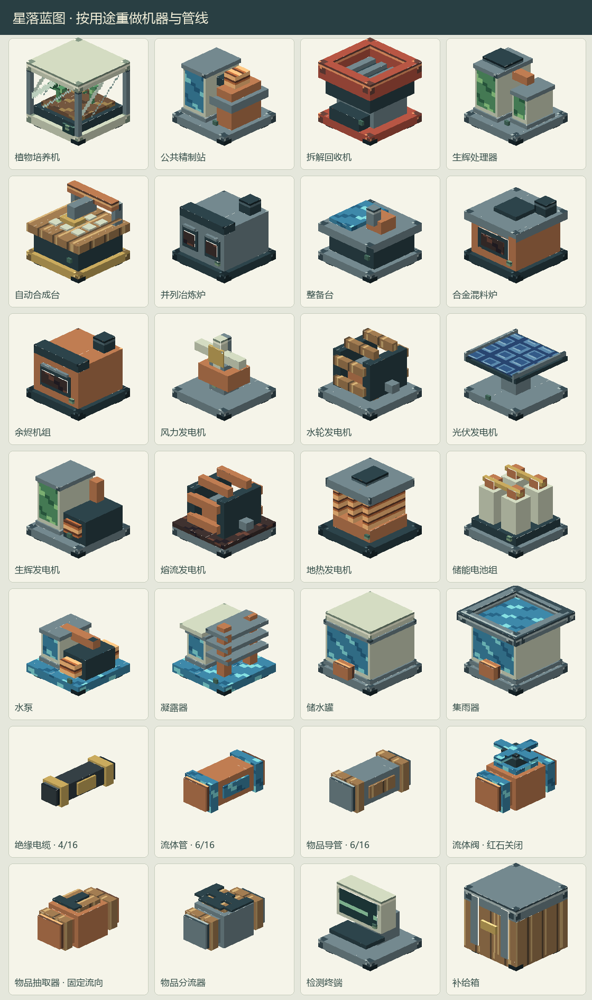

# 星落蓝图 · Starfall Blueprint

## 黑狗模块化与研发画布重构

研发改为自定义全窗口缩放／拖动画布。战甲改为24种分级基底／核心＋12种可并用、可独立拆回的功能组件，不再按能力替换整件护甲；增加真实立体装甲模型与挂载外观，旧腕表自动转换。现行玩法见[黑狗指南](docs/LINGCHUAN_BLACKDOG.md)，取代下文首批方案中的同部位互斥和旧负载数值。

## 岭川黑狗战甲首批（2026-10-29）

新增独立“贝斯特工务”和“岭川黑狗战甲”创造分类。岭川提供层相晶／层相合金、五种2×2×2专用机器、16节点树状研发、八部位制造、三阶能源核心、夜巡武装腕表整套收放与换件、慢充和外部充电，以及机动、防护、感知和武器分支。完整玩法与当前边界见[黑狗战甲指南](docs/LINGCHUAN_BLACKDOG.md)。

一款围绕探索、工业制造与灾后重建展开的 Minecraft Mod。从赤钛与灰硼起步，探索陨相矿，建造营地设备，把加工得到的晶料用于工具改造、资源补给与生产自动化，逐步建立自己的工业基础。

本模组专注探索、工业制造与科技玩法，沿用设定集中的材料体系与阵营技术风格。当前已提供公共基础工业原型、贝斯特轻型工程与第一台可驾驶工程机甲原型。**不涉及剧情内容：主支线任务、剧情NPC、对话演出与剧情阵营关系由另行开发的独立模组负责。** 本模组可独立游玩，技术成长不以剧情任务为前置。具体边界见[本模组开发范围](docs/SCOPE.md)。

**Minecraft 1.21.1 · NeoForge · Java 21**

澄海星与林海联盟仅作未来内容预留，待Minecraft官方新维度更新并适配后再实装。当前移除末地月络生成，停用月络进口及关联灵相材料、法杖坯工艺；其他现有维度不作为替代入口。预留物品ID与旧存档数据保留。

## 从一块矿，到一座营地

- **用辅矿建立工坊**：铁镐采赤钛与灰硼，先用普通熔炉制取辅料，再用整备台提高产出；制作绝缘材料、耐磨镶片与探索装备。
- **探索陨相矿脉**：在主世界地下发现普通与深层矿石。不同品位影响加工产量，时运附魔可增加原矿掉落，并提高获得高品位原料的机会。
- **建立基础生产**：用整备台将原矿加工为通用晶料，再通过省能接头降低后续生产消耗。
- **加工结构与电控材料**：用普通工作台和熔炉制作铁铜板、普通钢、陶瓷与绝缘料；获得陨相晶料后制作控制板、发电设备与产能模块，继续建设自动化。钢坯由合金混料炉加工。
- **改造随身装备**：从钛制耐磨到陨相加固，再到可选复合强化；用辅矿制造寻矿与采样装备，准备下一阶段探索。
- **学习贝斯特工务**：用开放配方制作轻型装配台，亲自学习并装配轻型助力骨架和工程钻切器；继续学习野外整备，制造便携整备包在外维修，或回装配台用水桶冷却设备；学习轻载通行后，可为骨架装配跨步组件，在疾跑助力与一格跨步档之间选择；也可独立学习工务诊断，用诊断器检查故障，回装配台隔离设备后检修并重新接通。见[贝斯特轻型工程](docs/BEST_ENGINEERING.md)。
- **驾驶工程机甲**：完成个人轻载通行和工务诊断学习后，在装配台学习驾驶并制造机体；从基地供能方块为打包机体充电，部署后乘坐，以WASD驾驶、G键使用工程臂。机体保存电量、温度、磨损与结构生命，停机后可下机、隔离、检修和回收；可在唯一通用槽安装散热模组或强化驱动模组，在持续作业与高耗能机动之间选择。独立工程臂槽支持拆装原装钻切臂，或换用耗电发热更低的挖掘臂处理土砂；右臂外观、作业费用及收纳状态随实际装配变化。机体自带真实9格货舱，也可安装强化机体扩为18格、提升结构与蓄能上限，并承担更慢、更耗能的移动代价；货物随保存与收纳保留，机体损毁后单独掉落。完整机体模块化、武器臂与重型平台继续后续开发。
- **按配方自动制造**：自动合成台从库存汇总材料，接入物流和电力后持续生产，无需手动摆放九宫格。
- **分档共振原版矿物**：地脉共振仪支持34种原版基底，基础5种产圆石、粗铜和粗铁；安装广谱共振组件后开放其余29种，包括紫水晶与远古残骸。四块同种基底永久保留。见[共振与凝矿](docs/RESONANCE_BASES.md)。
- **循环凝结模组原矿**：先制作凝矿框架，再定相制成专用基底，另行装配2×2×2相核凝矿阵。下层四格正下方放置四块同种陨相、赤钛或灰硼专用基底，每400刻消耗80000XH与500mB水，产对应原矿1份；陨相固定12%品位与I58。无需工具，基底及世界矿源不消耗，换基底选择下一批产物。
- **连续生产混凝土**：自动合成台制粉末，整备台用水硬化，配合泵、电缆与漏斗完成16色混凝土产线。
- **因地制宜供能**：用熔炉认可的燃料或岩浆桶驱动余烬机组，也可利用风、水流、日光、流动岩浆和篝火等热源供电。
- **循环培养植物**：保留环境方块与植物样本，用水和电持续产出作物、花草、原木及水生植物。
- **搭建营地补给**：利用储水罐、集雨器与漏斗连接供水和加工设备，让简单工坊逐步持续运转。
- **交付工务物资**：在工务终端用合格晶料换取有限的铁锭补给。

机器现在按用途建模：玻璃种植舱、精制塔、双炉门、机械合成台、叶轮、光伏板与电池组有各自的轮廓。电缆为4/16格粗，水管与物品导管为6/16格粗，放置后自动连接。普通设备顶部进料、底部出料，侧面连接供水和电力；红石信号停机，移除信号恢复。培养机不再提供方向、停机或复杂过滤按钮。见[界面与外观改版](docs/INDUSTRIAL_DESIGN.md)。

## 开始游玩

在 **Minecraft 1.21.1** 中安装 **NeoForge 21.1.262**，使用 **Java 21**，将本模组 JAR 放入实例的 `mods` 文件夹；联机时客户端与服务端均需安装。当前不需要其他前置模组。

进入世界后，用**纸与圆石**合成营地工务手册，查阅基础配方。先用铁镐采赤钛与灰硼，普通熔炉制取辅料，制作探索装备；再用铁镐采陨相矿并逐步建设加工与供水设备。矿石出现在新生成的主世界区块。

当前版本为 **0.1.0 开发原型**。本仓库暂以源码构建为交付方式，构建方法见下方文档。能源、物流与公共精制已接入；未来维度内容按专项计划预留。剧情内容由独立剧情模组开发。

旧版单格设备需拆移重放为完整凝矿阵，不会自动扩展或覆盖环境；已预约旧批次保留待产物并仅结算一次。遗留工具槽仅供空闲后取回旧物品，不再接受插入。

当前canonical包含312项物品、245条配方、178项图鉴，定形公共工作台配方114条。贝斯特首批完整构建及216/216项真实服务端GameTest通过，包含12项贝斯特专项；843份JSON、PNG和模型引用及专用装配边界检查通过。客户端与多人实机验收待后续进行。详见[本轮验证记录](docs/verification/2026-10-28-best-engineering.md)。野外整备扩展已完成编译打包与新增3/3项服务端专项，见[整备验证记录](docs/verification/2026-10-28-best-servicing.md)。轻载通行扩展已完成编译打包与新增5/5项服务端专项，含真实台阶碰撞，见[轻载通行验证记录](docs/verification/2026-10-28-best-mobility.md)。工务诊断与设备隔离扩展已完成编译打包，本轮新增5项与整备、轻载回归共13/13项服务端测试通过，见[诊断与隔离验证记录](docs/verification/2026-10-29-best-diagnostics.md)。开发文档中的其他测试数量按各阶段历史保留。

首台可驾驶工程机甲已完成编译打包与21/21项真实服务端验收，包含该批8项与诊断、整备、轻载13项回归；覆盖实际乘骑移动、钻臂保护、持续取电保护及保存收纳部署，详见[机甲原型验证记录](docs/verification/2026-10-29-best-mech.md)。后续装配台与HUD改进已完成24/24项服务端回归，并在真实客户端取得中英文各6张界面样例：四个直达标签、知识与材料预检、生命/电量/热量/磨损仪表及真实热锁状态。独立无世界截图不代替存档内按键、骑乘手感与多人验收，详见[机甲界面验证记录](docs/verification/2026-10-29-best-mech-ui.md)。

机甲通用模组扩展（2026-10-30）已通过编译、资源处理与新增3/3项服务端专项：互斥装拆与制造事务、保存收纳部署及死亡掉落、真实移动的动态耗电与散热恢复。本批未启动客户端或重复进行界面截图。操作与参数见[贝斯特工程指南](docs/BEST_ENGINEERING.md)。

可替换工程臂扩展（2026-10-30）已通过编译、资源处理与新增3/3项真实服务端专项：制造及装拆事务、旧存档与空槽兼容、保存收纳部署及死亡掉落、实际骑乘下钻切与挖掘的掉落、扣费和共享冷却。资源统计311项物品、245条配方、177项图鉴；凌川既有资源与翻译保留。本批仅做必要定向检查，未启动客户端或界面截图。装配台新增工程臂页，操作见[贝斯特工程指南](docs/BEST_ENGINEERING.md)。

强化机体与真实货舱扩展（2026-10-30）已通过编译、资源处理与新增3/3项真实服务端专项：升级及拆回的原子边界、真实货舱菜单与快捷转移、保存收纳部署及损毁掉落、四种机体／驱动组合的实际移动和动态容量。本批资源统计312项物品、245条配方、178项图鉴；未启动客户端或重复进行界面截图。操作和完整参数见[贝斯特工程指南](docs/BEST_ENGINEERING.md)。

## 文档

- [玩法、配方与构建指南](docs/PROJECT_DETAILS.md)：生存起步、设备操作、加工规则与本地构建。
- [蓝图施工器与文件分享](docs/CONSTRUCTION_BLUEPRINTS.md)：材料清单、一键施工、测绘、导入导出和23份公开蓝图。
- [材料与制造阶段](docs/MATERIAL_PROGRESSION.md)：辅矿起步、陨相升级、精制复合及可选后期材料。
- [能源与热源利用](docs/ENERGY.md)：多燃料与岩浆桶、熔流发电、篝火及岩浆源地热。
- [自动合成台](docs/AUTOMATIC_CRAFTING.md)：库存配料、批量数量与模组配方扩展。
- [混凝土流水线](docs/CONCRETE_PRODUCTION.md)：16色粉末硬化、供水供电与漏斗接线。
- [植物培养机](docs/PLANT_CULTIVATION.md)：环境、88种植物样本、循环产物与供水物流。
- [开发进度](docs/PROGRESS.md)：当前已实现的模块与后续工作。
- [实现说明](docs/IMPLEMENTATION.md)：技术机制、兼容边界与阶段验证记录。

## 美术与使用

采用石板灰、铜色与青绿晶体组成的原创像素美术，包含方块、物品和工业界面。

项目当前未声明开源许可证；代码、设定与美术的使用权限以权利人授权为准。
