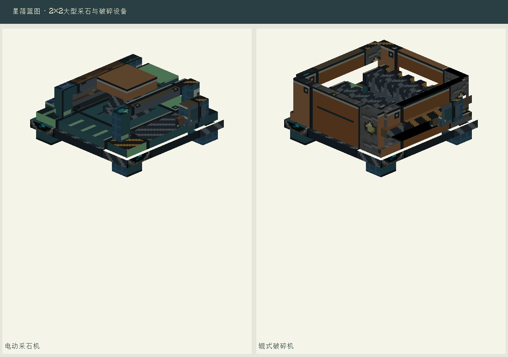
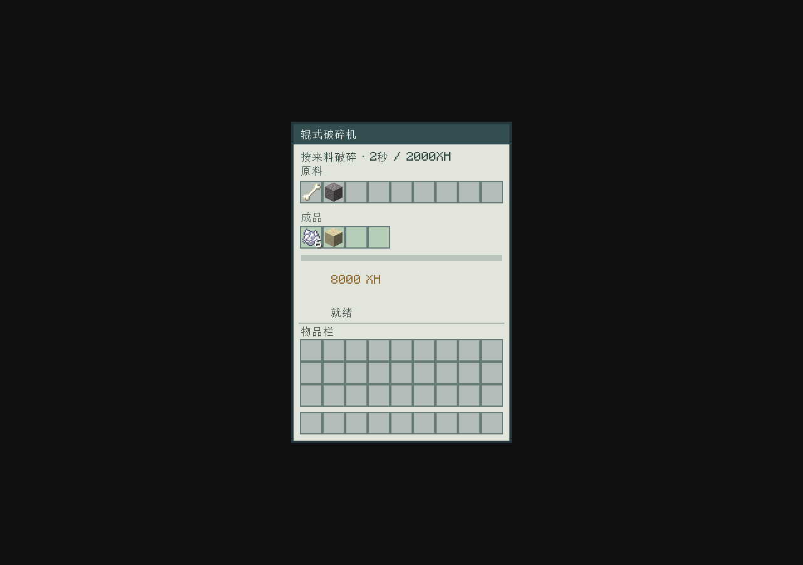

# 大型采石与通用破碎

两种新机器均实际占地2×2，一件物品放置成四格；四格共享库存、能量与加工进度。点击任意部位使用；拆任意部位返还一件保存数据的机器。任意部位收到红石信号均暂停，缺料、缺电或输出堵塞不重复扣料。

采石机：机架2、铁板2、普通钢基材2、控制板1、钢制固定件1、铁镐1。四格铺石质地基、前方两格留空，供电后每10秒消耗4000XH产4圆石，不消耗地基，不挖世界，不依赖刷石结构；后侧取料。

破碎机：机架2、铁板2、普通钢基材2、控制板1、钢制固定件1、活塞1。按来料自动加工，每批2秒／2000XH；上方、前／左／右侧进料，后侧和底部取成品。

| 输入1件 | 输出 |
| --- | --- |
| 圆石 | 沙砾1 |
| 沙砾 | 沙子1 |
| 骨头 | 骨粉6 |
| 烈焰棒 | 烈焰粉3 |
| 骨块 | 骨粉9 |
| 砂岩 | 沙子4 |
| 红砂岩 | 红沙4 |
| 萤石 | 萤石粉4 |
| 石英块 | 下界石英4 |
| 紫水晶块 | 紫水晶碎片4 |

骨头和烈焰棒提高产率；可逆压缩块仅原量回收，避免材料增殖循环。不会破碎任意矿块来绕过矿物品质或掉落规则。

## L26无需补料的混凝土线

在施工器放入设计图，扫描目录选择L26。建成后只给培养机首次放泥土和铃兰样本，保留不消耗。风机须露天、采石机前方留空，区块保持加载。两条采石支路独立制沙砾和沙子，无需调分流比例；凝露供水，预设自动合成白染料与粉末，再由统一整备台水化，成品箱收混凝土。

无需人工补煤、骨料或染料。理论匹配48混凝土／分钟，实际受供能和输送影响，首次需等待缓冲。真实服务端从空水电缓冲、无外供原料开始已产出16白色混凝土。

大型机器蓝图须包含完整四格，材料只算一个机器物品；拒绝孤立外壳。四个方向旋转、施工失败回滚与不扣料规则继续有效。

