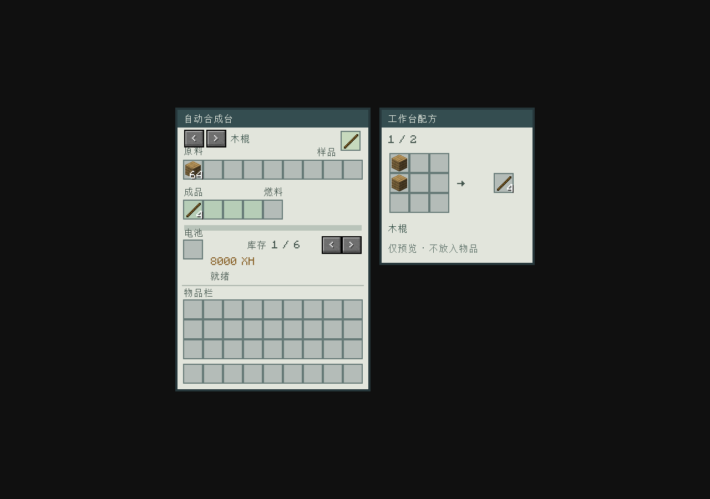

# 自动合成台：库存式配料与扩展配方



自动合成台按选定配方从库存汇总材料，不把实际库存当作工作台九宫格。界面右上角有一个独立的“样品”槽：放入想制作的成品，机器即选择该物品对应的工作台配方，再向原料库存补料、供电即可持续生产。样品槽只放1件，样品不参与生产消耗、不被物流抽走，允许随时取回或Shift取回；取回后保留已选配方。

同一物品有多个工作台配方时，箭头只在该样品对应的配方中切换。没有工作台配方的物品会显示“无工作台配方”并停止启动新批次；样品不代替原料，不复制样品的名字、附魔或其他数据到成品。加工中替换样品只改变下一批，已预留的当前批次照常完成。蓝图和旧存档中的配方预设在未放样品时继续有效。

候选只展示支持的3×3工作台配方，不混入熔炉、高炉、切石、锻造、辊压或大数量自动化专用配方；未开放的图鉴配方也不显示。同一产物的不同工作台原料仍可切换。右侧常驻九宫格预览，保留定形空位，显示实际成品数量和当前方案序号；标签原料轮换展示可用物品，悬停可看名称。预览格只显示材料，不是可放物品的库存；点击不会丢出鼠标持有物。原料仍从54格库存汇总，无需按预览摆放。只有一种方案时箭头禁用。

## 使用与容量

- 原料库存54格，界面分6页，每页9格；自动化能访问全部输入格，不受当前查看页影响。输入从上方或侧面进入，底部取出成品和余物。
- 单个物品堆叠仍遵循原版上限。配方需要128份材料时可分成多堆，机器汇总扣除，不需要制造超限物品堆叠。
- 额外无关原料不影响配料。原料保留数据组件，品质、损伤、附魔和来源等限制继续由原配方检查，不把不同组件物品混成同一种原料。
- 开始一批前检查全部成品和容器余物是否能放入输出库存；不足时不扣原料或能量。启动后只预留一次，欠能/输出堵塞暂停，保存与拆移保留进度和待产物。
- 每批40刻（2秒）、4000XH，输出仍为4格。材料容量、输出容量、物品堆叠上限和品质门槛依然有效；不是无限大小的配方执行器。
- 已有9格输入保留为第一页，旧模板和在制批次保留；各玩家查看页互不影响。

## 普通配方兼容

原版和其他模组的标准 `ShapedRecipe`、`ShapelessRecipe` 可自动从库存安排逻辑原料。定形配方的形状仅用于在内部构造输入，玩家不需要摆放。机器调用原配方的 `matches`、`assemble` 与 `getRemainingItems`，保留动态成品、组件检查及容器返还行为。

本模组图鉴、整备升级、隔离基底、集雨器升级与双件修理配方提供显式布局适配。集雨器升级继承输入罐中的水，设备物品和容器可以作为自动合成原料。允许容器输入不代表自动打开容器并使用其中的物品。

不能仅由成品或 `getIngredients()` 推断任意特殊配方的内部规则。未知自定义工作台配方需要提供下方布局适配并可在3×3工作台完成，才会进入样品候选；熔炼、锻造、流体、多机器步骤与需要玩家动作的配方不自动转换为工作台配方。样品查找使用已加载、机器支持且声明成品与样品相同的配方，不要求玩家先打开配方册；不能声明固定成品的动态特殊配方仍需有效预设，不能凭样品猜测。

## 数据包：数量配方

此扩展保留给旧模板或显式预设，不进入玩家的工作台配方候选或九宫格预览。配方文件放在 `data/<命名空间>/recipe/<名称>.json`，类型为 `starfall_blueprint:bulk_crafting`。以下仅为格式示例，不默认加入游戏：

```json
{
  "type": "starfall_blueprint:bulk_crafting",
  "inputs": [
    {"ingredient": {"item": "minecraft:iron_ingot"}, "count": 128},
    {"ingredient": {"item": "minecraft:copper_ingot"}, "count": 128}
  ],
  "result": {"id": "starfall_blueprint:machine_frame", "count": 1}
}
```

每条需求声明 `Ingredient` 和总数量，可使用标签或NeoForge自定义原料。支持1—54条需求，每条数量1—3456、全部需求合计最多3456；实际可用容量还受不可堆叠物品和不同组件占格影响。需求可超过9种，单项可超过64份。标签原料与特定物品重叠时按整体可行分配取料，不让宽泛需求抢走专用材料。默认按实际消耗物品返还容器；需要特殊余物或动态成品时使用代码接口。

## 模组接口

`cn.starfall.blueprint.AutomaticCraftingLayout` 适合仍可按逻辑工作台执行的自定义 `CraftingRecipe`：返回宽、高和包含空位的原料列表。当前最多54个逻辑格，允许大于3×3；最终仍调用配方自身匹配、装配和余物方法。

`cn.starfall.blueprint.AutomaticCraftingRecipe` 适合数量、组件或余物规则无法从工作台推断的配方。将实现该接口的配方正常注册到RecipeManager即可；方法为：

```java
Optional<AutomaticCraftingRecipe.Plan> planAutomaticCraft(List<ItemStack> inventory, Level level);
```

传入的是脱离真实库存的快照。返回计划的 `consumed` 与库存槽一一对应，写明每槽消耗数量；`outputs` 必须包含全部成品和余物。规划方法应确定、无副作用，不修改世界、玩家或机器，不自行扣能或发物品。机器验证计数与容量，再一次性预留。接口不豁免配方自身应执行的组件、品质及其他限制。

普通布局匹配对不同数据组件的候选尝试设有8192次搜索预算，极端歧义配方可能拒绝开工；此类配方应实现库存计划接口以提供明确匹配。当前提供接口及本模组/原版验证，不宣称已与所有第三方模组实测兼容。
