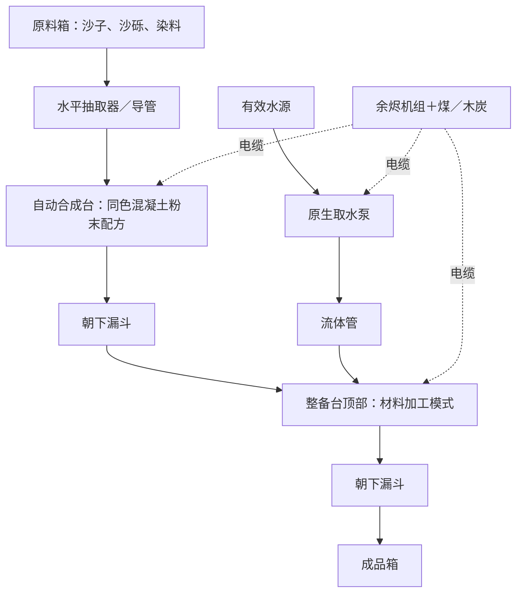

# 用现有机械搭建混凝土流水线

本功能沿用现有自动合成台、整备台、取水泵、电缆与物流，不增加新机器。沙子、沙砾、染料和燃料需从外部持续供应；产线负责从这些原料到原版混凝土成品的加工，不自动采砂或种植染料。

## 加工步骤

| 工序 | 输入 | 输出 | 工时／相能 |
| --- | --- | --- | --- |
| 自动合成台 | 沙子4＋沙砾4＋对应染料1 | 同色混凝土粉末8 | 40刻／4000XH，沿用原版配方 |
| 整备台：材料加工模式 | 同色混凝土粉末8＋普通水1000mB | 同色原版混凝土8 | 40刻／4000XH |
| 原生取水泵 | 下方有效水源 | 普通水1000mB | 20刻／1000XH |

16种颜色各有独立湿法硬化配方，VC-01—VC-16依次为白、橙、品红、淡蓝、黄、黄绿、粉红、灰、淡灰、青、紫、蓝、棕、绿、红、黑。不混色，不提高固体产量，不返回水桶；水在湿法工序中消耗。保持原版粉末遇水硬化规则，机器提供额外的罐内加工方式。

## 最简布置

把自动合成台、漏斗、整备台、漏斗、成品箱从上到下堆放；两只漏斗都朝下。

1. 自动合成台选择原版对应颜色的混凝土粉末配方，例如 `minecraft:red_concrete_powder`。普通配方需先在玩家配方册学会。顶面、侧面都可供料，不需要九宫格摆放。
2. 潜行空手右击整备台，进入并保持**材料加工模式**。默认按来料自动选择可用工序，也可选定对应VC配方。普通空手右键会切回原矿模式，使材料批次暂停；切回材料模式后续作。
3. **整备台材料原料从顶部进入；侧面只接燃料槽13。** 不要让侧向漏斗直接把粉末送进整备台侧面。底部漏斗自动取走成品。
4. 取水泵下方放有效水源，用流体管接到整备台；普通水可从任何流体面输入。4000mB入口罐缓存4批。有限水源规则关闭无限水时，泵会实际移除水源，需要补水，也可使用凝露集水器替代。
5. 用电缆将现有电源接到自动合成台、整备台和泵。两工位工作功率各100XH/t，泵工作时50XH/t；一台500XH/t余烬机组可带动这条短线。供电网络轮换可达目标，避免只填满某个空闲大缓存而饿死其他工位。

远距离输送时，可用“机器下方漏斗→中间箱→水平抽取器／导管→整备台顶部”。现有抽取器只支持水平朝向，不能直接从机器底面抽货。

## 产量与暂停

- 两工位的理论加工能力均为每2秒8件，即240件／分钟；一只原版漏斗最多2.5件／秒，因此以上单线持续吞吐上限为150件／分钟，供料不足还会降低。共用物流网也受每秒8件、每抽取器每秒4件的预算影响。
- 每8份混凝土需要1000mB水，两道加工共8000XH；若由原生取水泵供应这1000mB水，总工序耗能为9000XH。储水罐预充水、储能损耗及原料获取另计。
- 少于8份同色粉末、缺水或输出无空间时不开新批次，不扣水和粉末。没有可用电量且没有可用燃料时不开工；已启动的批次按刻扣能，欠能或出料堵塞时暂停。
- 预留的粉末、水与待产物只结算一次，NBT保存重载后从原进度继续，不补算离线产量。

## 本阶段验证

最终完整构建及97/97项真实NeoForge服务端测试通过。新增3项回归覆盖16色原版粉末合成和湿法硬化、不混色／缺水／背压／断电与NBT续作，以及真实箱、抽取器、两只漏斗、煤发电、电缆、管道与泵组成的两批连续产线。已有工业工序遍历从12条扩为28条。

首次整线验证暴露接料面错误和供电目标饥饿，修正后集中复验通过；没有追加客户端、压力或第三方整合包测试。详见[验证记录](verification/2026-10-22-concrete-gametest.txt)。
