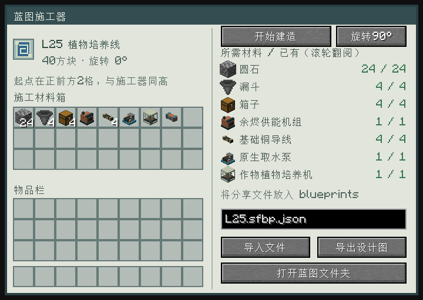
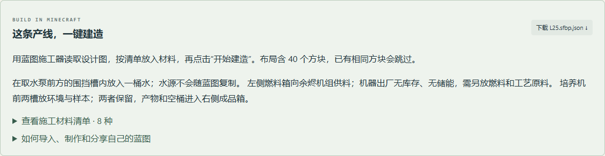

# 蓝图施工器

放入设计图后，施工器列出每种方块的“需要／已有”数量。把方块放入27格施工材料箱，点击“开始建造”一次完成。材料可用漏斗补入，也会自动读取施工器六个面紧贴的箱子、木桶和潜影盒；相邻大箱子的两半均可使用。右侧已有数量实时合计内部与外部库存，优先消耗内部材料，只有建造成功才扣除。设计图不会消耗，可以重复施工；已有相同方块会跳过，不重复收费。

施工区域近边在施工器正前方2格，与施工器同高。设计图沿该方向向前展开；旋转后仍保持在前方。“旋转90°”同时旋转布局与机器朝向。请预留足够空地。材料不足、位置被占用、区块未加载、方块缺支撑或保护规则阻止时，本次不扣材料；中途被阻止会撤回本次放置。红石信号暂停施工。

## 制作

**创造施工核心**：仅从创造物品栏获取，无生存配方或自然掉落。将核心放进施工器任意施工材料格，保留左上角的设计图，即可免材料一键建造；核心、设计图和已有建材均不消耗。材料表会显示“∞”。移除核心后恢复正常扣料。核心只免除材料需求，仍需空地、支撑、已加载区块和施工权限，也遵守红石暂停。

- **空白设计图**：纸＋蓝色染料，无序合成。
- **蓝图测绘笔**：木棍＋铁锭＋蓝色染料，无序合成。
- **蓝图施工器**：上排铁／铜／铁，中排控制板／发射器／基础机架，下排铁／红石／铁。

## 使用产线示例

游戏首次加载时，会把21份已开放产线蓝图放入当前实例的 `blueprints` 文件夹，保留玩家已有的同名文件。HTML说明手册的每条产线也有“下载蓝图”按钮与完整施工材料表。两处提供的是同一份 `.sfbp.json` 文件。

1. 制作并放下施工器，准备一张设计图。
2. 把设计图放入左上角，点击“扫描目录”，直接点选列表里的蓝图即可导入，不必手填文件名。列表显示蓝图名称与方块数量，悬停可查看文件名；支持翻页、滚轮与重新扫描，按Esc或“返回材料”回到材料清单。没有放设计图时，点选会先填入文件名，放入设计图后再点击“导入文件”。也可手动填写 `L25.sfbp.json`（植物培养线）等名称。
3. 按右侧清单向施工材料箱或紧贴施工器的箱子放入方块；滚轮可查看完整清单。
4. 点击“开始建造”；按蓝图说明补入燃料、工艺原料及水源。

L24为白色混凝土示范线：自动合成台预设白色混凝土粉末，漏斗下送到整备台，再送成品箱。L25包含培养机、供能、供水和出料结构；环境与样本需自行放入。精制等工位的工艺夹具需按图册另行安装。多工位通用布局注明了哪些阶段需在输入箱之间周转。

## 自己测绘与分享

背包放一张空白设计图，手持测绘笔右键选区的两个角，得到设计图。潜行右键清除第一角。把成图放入施工器，点击“导出设计图”；把生成的文件发给其他玩家，对方放入自己游戏目录的 `blueprints` 文件夹再导入即可。导出遇到重名会另存新文件。

多人游戏由客户端读取本地文件，传给服务端验证；施工和扣料均由服务端执行。远离施工器或关闭界面后，旧的导入请求不能改写其设计图。

“打开目录”会打开当前实例的 `blueprints` 文件夹。扫描只列出该目录直接包含的 `.sfbp.json` 文件，最多256份，不扫描子目录。损坏、超限或不安全的文件显示为无效并禁用点选，悬停查看原因；新增、删除或修改分享文件后重新扫描即可。真正导入时会重新读取文件并验证内容。

设计图记录方块、朝向、工艺模板和整备台旧版兼容标记；不复制箱内物品、燃料、储能、液体、在制批次或实体。带保存数据的已拆机器和非空容器不能当作空白施工材料消耗。当前每份最多512个方块，尺寸48×32×48；液体需要另行注入。门、床和高植株等多块联动方块暂不支持，导入时明确报错。

## 文件与重建

格式为UTF-8 JSON，扩展名 `.sfbp.json`。头部 `format` 为 `starfall_blueprint`，`version` 为1；`blocks` 每项含 `pos`、`block` 和可选的 `properties`、`recipe`、`material_mode`。本地坐标X为右、Y为上、负Z为前。材料表由实际方块重新计算，文件中附带的材料说明不参与扣料。

在文档项目的 `04_游戏设定/产线图册` 运行 `python build_atlas.py`，然后在Mod项目运行 `python tools/sync_blueprints.py`。新增工具资源由 `python tools/generate_blueprint_resources.py` 生成；施工器模型随工业模型生成器更新。

## 客户端界面

