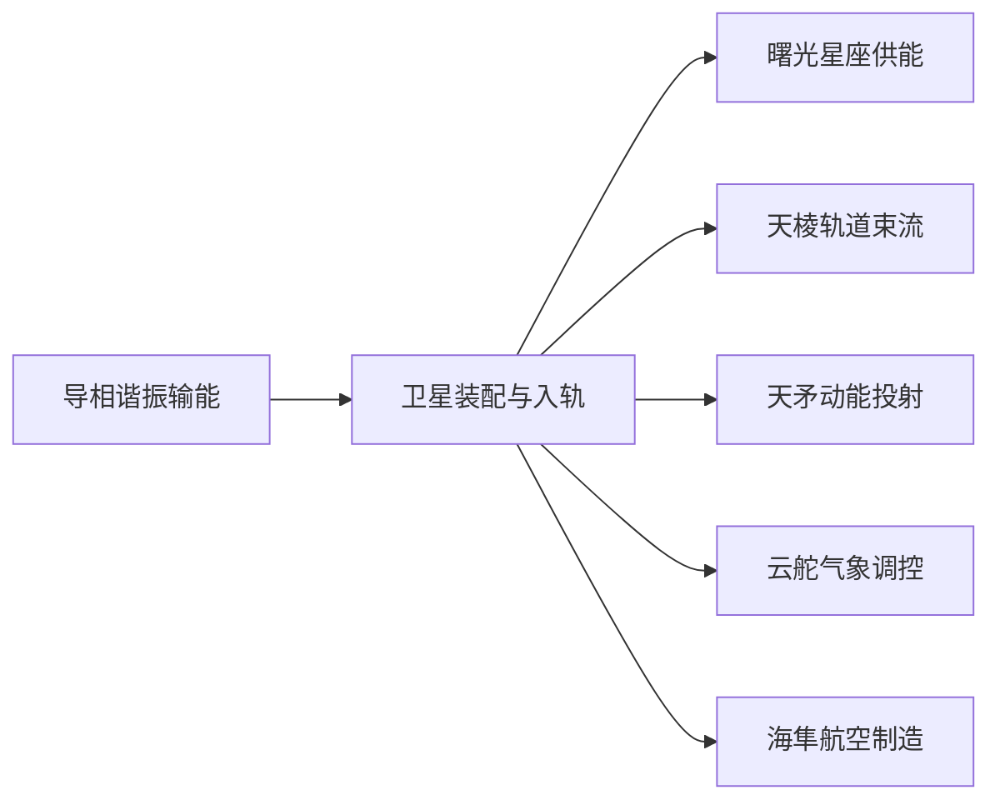
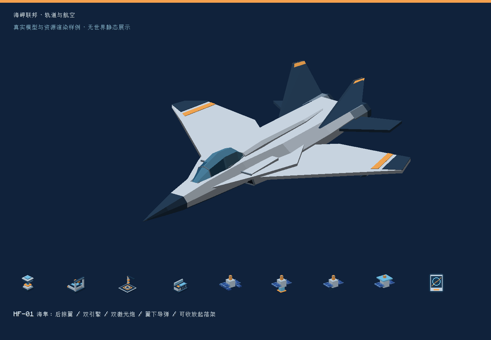

# 海岬联邦：轨道与航空科技

2026-11-14 实现，已包含设施扩建、终端重做与飞行平滑修正。Minecraft 1.21.1 / NeoForge 21.1.262。国家沿用海岬联邦；银白机壳、深蓝结构、冰蓝导相光与警示橙形成统一视觉。科技不依赖剧情模组，不要求学习贝斯特或岭川个人专精。

## 七项个人研究

从背包“成长 → 海岬轨道”进入。普通工业部件开放工作台制造；研究限制专业装配、发射、能力与驾驶，避免以成品作为解锁自己的前置。



前两项各交付导相铜复材板4、基础控制板2、经验等级3；后五项各交付导相铜复材板8、基础控制板4、经验等级8。知识随死亡重生保留。创造玩家可直接使用专业设备，研究界面仍显示实际学习记录。

## 设备与交互

| 成品 | 形态与用途 | 使用 |
| --- | --- | --- |
| 回声·导相无线输能塔 | 底座、竖向谐振芯、双环发射头；8格球形供电范围 | 接公共电缆或发电机供电；终端依次右键两塔建立双向中继；潜行右键塔清除其全部连线 |
| 织星·卫星装配台 | 深蓝工位、升降承台、橙色装配臂 | 右键打开专业装配配方；悬停成品按钮看全部材料、电费和知识 |
| 天阶·轨道发射台 | 四角警戒边、中央发射座、侧支撑塔 | 右键选择卫星；每次耗对应卫星1、天阶运载火箭1、200,000 XH；平台中心上方、设施顶端以外直到世界顶端须净空 |
| 环港·星座调度台 | 双层航电机柜、蓝屏、橙色状态灯 | 浏览星座能源和数量，明确开启／暂停随身充能；选择激光或钨棒标记能力，直接调用晴天、降雨、雷暴 |
| 领航者·卫星便携终端 | 银白掌机、环轨显示屏、橙色操作条 | 潜行右键打开调度界面；选激光或钨棒后关闭界面，普通右键标记目标；天气在界面内直接调用 |

四种地面设备均占用实际多方块空间，尺寸按宽×深×高为：回声塔2×2×3、织星台3×3×3、天阶台5×5×4、环港台3×2×2。一次放置完整设备，空间不足整笔拒绝，不覆盖建筑；任意外壳交互、接电均归属同一控制器，只有一份2,000,000 XH缓冲，端口最大收发8,192 XH/次。拆除任何一块会拆解整座，掉落一个设备物品。旧版单格设备需拆除后重新放置，不会自动扩建覆盖周围建筑。右键供能塔直接显示储能和连接数。终端拿在任一手时可见8格覆盖环、塔间链路和流动光点，收起终端隐藏覆盖层。

每塔最多8条双向中继，单跳最多64格，中继每次最多4,096 XH，按储能差均衡。机器无线服务总预算2,048 XH/刻，目标每20刻轮询；无线目标必须具有可接收能源接口。中继不制造能源，也不强制加载区块。红石信号暂停该塔的中继与无线服务；卸载区块中的节点停止工作，重载后恢复。破坏工位会丢失内部储能，先断电再拆移；连线在两端加载后校验清理。

## 卫星星座

卫星按玩家UUID保存在主世界SavedData中，死亡、重启和切换维度不会复制或丢失星座。服务覆盖同一世界的远方位置，不受地面塔范围限制。每类在轨数量最多16颗，后续发射叠加能力或资源储备；天矛达到16颗后仍可发射补给卫星，补弹而不增加在轨数量。默认使用个人星座；可在终端、调度台或发射台切换至原版队伍共享星座，操作见下文。个人星座始终单独保留。

| 卫星 | 单颗效果 | 调用消耗与限制 |
| --- | --- | --- |
| 曙光·充能卫星 | 自带太阳翼，400 XH/刻；每颗提供基础4,000 XH/秒随身充电预算，可发射加强卫星提升 | 携带终端即可，每刻轮询主背包、快捷栏、护甲及副手，轮换优先级；支持电池、贝斯特工具与收纳机体、黑狗腕表、收纳海隼及其他提供标准能源接口的物品 |
| 天棱·激光卫星 | 自带太阳翼，80 XH/刻；解锁轨道激光 | 每次250,000 XH，冷却10秒；瞄准点Y坐标直接落点，3秒预警；基础伤害80、半径4格、爆炸2.5，可通过基础与加强卫星提升 |
| 天矛·动能武器卫星 | 自带太阳翼，80 XH/刻；首次发射装载8根钨棒 | 每次600,000 XH与钨棒1，冷却30秒；瞄准点Y坐标直接落点，5秒预警；基础伤害220、半径12格、爆炸8，可通过基础与加强卫星提升 |
| 云舵·气象卫星 | 自带太阳翼，80 XH/刻；晴天、降雨、雷暴 | 每次400,000 XH，共享120秒冷却，改变主世界全局天气10分钟 |

每颗卫星增加2,000,000 XH星座容量，总容量上限64,000,000 XH；各服务共享储能。终端提供“随身充能”和“方块破坏”开关，以及“个人／队伍”舰队切换；暂停充能停止向装备输电，太阳能仍继续为星座蓄电。武器以“选择能力”操作启用，不再显示四个含糊的总开关。补算时间最多24,000游戏刻，避免长时间离线积累无限能量；不使用电脑现实时间。

充电始终扣除能源接口实际接受的输入量，接口自身转换损耗照常发生。无终端不充电，地狱等无天光维度不充电。携带终端不会凭空产生能量；新发射卫星不会赠送满电。

终端打击以服务端视线射线确定落点，最大192格，要求主世界、已加载区块、世界边界内、交互权限，不判断室内或露天，不将落点移到屋顶。标记后显示范围圈、旋转定位弧和引导光柱，落点延迟到达；结算时再次检查操作者在线、存活与权限，不再检查头顶遮挡。操作者离线或无权限会失效，已付资源不退回。直接伤害按距离衰减，并检查目标与落点间遮挡；爆炸保留原版实体伤害与事件，地形破坏由下述独立开关与坑形逻辑控制。

同一类型多颗卫星共享冷却，不允许通过多终端绕过。钨棒补给统一通过天阶发射台再次发射完整天矛卫星，每次消耗天矛卫星1、运载火箭1与200,000 XH，增加8根弹药。即使已有16颗天矛，仍能发射补给卫星，但数量不再增长。弹药上限256，剩余空间不足8根时拒绝发射，不浪费载荷。调度台与终端均不提供单根远程补给。当前星座服务不模拟轨道位置、寿命、真实气象物理和星体维度；空投、侦察无人机等旧设定节点不属于这一批。

### 方块破坏与坑形（2026-11-16）

终端与调度台底部可切换“方块破坏”，默认关闭，旧存档也默认关闭。关闭时激光和钨棒仍伤害实体，但原版爆炸也不会破坏方块。该设置属于当前舰队，发射时连同升级强度一起锁定；修改开关不会改变已经标记的打击。

- 激光形成狭窄深坑：基础向下12格，每级加强增加7格，8级向下68格；坑半径从2格增至6格，边缘逐渐变浅。
- 钨棒形成宽阔的碗状扩散坑：半径跟随实体杀伤半径增长，最大28格；基础中心深8格，每级增加2格，8级深24格，向边缘逐渐变浅。
- 深度均相对瞄准落点，受世界高度、已有地形和保护限制。每个打击每刻最多扫描2,048个位置、直接改动512块；所有维度的卫星打击共用每服务器刻最多1,024次实心方块处理、8,192次扫描与约3毫秒的软时间预算，预算用尽后下一刻继续。单个方块或保护模组回调不能中途抢占，因此时间预算不是硬性耗时保证。进度随实体存档保存，只处理已加载区块，不强制加载。
- 批量移除不再为每一格广播破碎粒子和声音，保留整次打击特效以及正常方块回调、邻居更新、光照和客户端同步；有效坑形按几何参数缓存，直接跳过坑形外位置。新打击按从上到下的水平层推进，每层从中心向外扩散，避免从侧面逐列切开造成条带刷新，也减少同一批次跨越大量垂直渲染分区。大坑会逐层形成，较低负载下每刻可处理更多方块，仍受统一软时间预算限制。已保存且开始挖掘的旧打击沿用原游标顺序直至完成，避免恢复后跳块或重复挖掘。
- 逐块检查边界、世界交互权限与 NeoForge `BlockEvent.BreakEvent` 取消状态；跳过不可破坏方块和含流体方块，不生成方块材料掉落。具体领地模组须支持该破坏事件。

### 多人共用一套卫星（2026-11-16）

复用原版 `/team` 队伍。管理员可执行以下命令（将名字替换为实际玩家名）：

```mcfunction
/team add orbital
/team join orbital Alice
/team join orbital Bob
```

各成员分别在发射台、终端或调度台点击“舰队：个人”，切换为“舰队：队伍共享”。此后在发射台发射的卫星、加强卫星及钨棒补给都进入队伍舰队；每次仍从当前操作者背包取载荷和火箭、从发射台扣电。队友携带自己的终端，选择同一队伍舰队即可充能、呼叫武器和天气。

队伍共享在轨数量、升级、储能、弹药、各项冷却、充能开关和方块破坏开关。并发请求由服务端串行校验，不会因多人或多个终端绕过冷却。每个成员仍须独立解锁对应研究，使用武器时按实际操作者检查权限。共享选择随玩家UUID保存；队伍星座按队伍内部名称保存，离线成员不会导致资源丢失。

个人与队伍资源不合并、不复制、不自动转移。点击切回个人即可继续使用原有个人卫星；离队立即失去原队伍访问权，无队伍时自动使用个人舰队。若保留共享选择后加入另一队伍，则使用新队伍的舰队。删除队伍后以相同内部名称重建会重新关联原队伍星座，管理员应避免将旧队名分配给无关队伍。创造终端继续使用个人临时满配服务，不向生存共享舰队赠送卫星或能源。

## 配方与流水线

下表是工作台无序配方，也能由已有自动合成台处理。所有耗材均有实物来源；新黑钨矿属于普通金属矿，不是另一种陨相晶矿。它在主世界新生成区块Y=-48…16出现，四次/区块、矿脉大小4，铁镐开采；熔炉200刻或高炉100刻烧成钨锭。旧区块不会补矿。

完整配方表见本文后半部。建议将工厂划分为四条共用物流的生产线：

1. **公共材料区**：现有陨相加工提供导相铜复材板、承相结构嵌材、传感材料；普通钢、铜板、绝缘料、陶瓷、控制板、固定件由已有工艺供给。水管继续服务公共加工段。
2. **谐振电控区**：自动合成台A专产线圈，B专产航电处理器，C用两者装配回声塔。每座塔需要A运行2批，B运行1批，C运行1批；线圈每批产2，共4件。每塔展开总需求为导相板9、铜板4、绝缘料4、控制板2、传感材料1、石英2、金锭1、机架1、陶瓷1，未继续展开公共材料自身配方。
3. **航天总装区**：太阳翼、卫星平台、姿控组件三条线并行；织星台按目标卫星消耗这些件与专属载荷。运载火箭线独立缓存，与卫星成品配对送往发射位。末端总装从玩家背包取料，需人工确认；其上游中间件可以持续自动生产。
4. **航空与弹药区**：机身、引擎、激光阵列进入织星台组装海隼；钨矿→冶炼→钨棒、火药→航空导弹以及TNT→航空炸弹三条支线独立备货。钨棒供卫星，航空导弹装入飞机，两者不可互换。

起步必须先用电缆给公共自动合成台供能，制造第一座无线塔后再扩展覆盖，避免无线塔依赖尚未制造的无线塔。塔间每隔48～60格布设中继，在工坊内按覆盖环安排机器；空白中继不能替代地面发电与储能。物流使用既有导管、提取器、路由器及缓存箱，卫星发射与专业总装保留人工操作。

### 织星台专业总装

| 成品×1 | 材料 | 用电 |
| --- | --- | --- |
| 曙光卫星 | 卫星平台1＋太阳翼4＋线圈4＋姿控1 | 160,000 XH |
| 天棱卫星 | 卫星平台1＋太阳翼2＋激光阵列2＋姿控1 | 320,000 XH |
| 天矛卫星 | 卫星平台1＋太阳翼2＋天矛钨棒8＋姿控1 | 320,000 XH |
| 云舵卫星 | 卫星平台1＋太阳翼2＋气象阵列2＋姿控1 | 240,000 XH |
| HF-01海隼 | 机身总成1＋涵道引擎2＋激光阵列2＋航电4＋线圈8 | 640,000 XH |

专业总装与发射都先检查知识、全部材料、可用电量和输出空间，再一次性提交。失败不扣任何材料或电量，重复点击无法无料复制。此批总装采用即时耗电制造，没有虚构未实现的生产进度条。

## 海隼战斗机：飞行与三种武器

HF-01采用连续收尖机鼻、切面玻璃座舱、薄型后掠翼、双涵道引擎、外倾双垂尾、翼下导弹与航空炸弹。第三人称镜头平时距离约11格，强推力时平滑拉远至14格；仍由原版相机碰撞检查避免穿墙。驾驶员和第一人称手持物在机内隐藏，下机恢复。

| 输入 | 功能 |
| --- | --- |
| W / S | 增加／减小油门，松开保持 |
| 空格 / Shift | 抬头／压头；地面俯仰限制-12°至8°，离地后±65° |
| Q / E | 左／右滚转，空中限制±75° |
| A / D | 左／右偏航，空中基础3.4°/刻，地面转向较缓 |
| F | 5格内可见机体上机／下机 |
| 鼠标滚轮 | 循环切换重束激光、追踪导弹、重力航空炸弹；不会切换背包快捷栏 |
| 鼠标左键 | 发射当前选择的武器，按住可连续射击 |
| 鼠标右键 | 不再需要锁定操作；左键开火时自动捕捉准星附近的可见目标 |
| Ctrl（按住） | 启用强推力，大幅提高加速度与最高速度；松开后依惯性逐渐回落 |

旧R／V机载开火绑定已取消。打开界面或下机后立即交还鼠标输入，并清除射击、锁定状态。

### 武器与装填

| 武器 | 射击规则 |
| --- | --- |
| 重束激光炮 | 160格射程，1.25格辅助命中走廊，粗亮束芯与外晕；单次伤害24，消耗12,000 XH，冷却6刻（0.3秒）。开火时光束自动朝准星附近目标修正，墙壁仍截断激光 |
| 追踪导弹 | 冷却8刻（0.4秒），每次消耗导弹1与4,000 XH。开火时自动选取目标并持续追踪，计算小幅提前量；准星附近没有目标则直射。爆炸强度3，不破坏方块 |
| 重力航空炸弹 | 飞机离地后从机腹投放，携带飞机当前速度，再按重力下落；每次消耗炸弹1与2,000 XH，冷却12刻（0.6秒）。碰撞爆炸强度5，具有实际方块破坏力 |

正常飞机电池2,000,000 XH、结构160、导弹仓16、炸弹仓8，新造机体空电空弹。手持对应导弹或航空炸弹右键机体逐枚装填。收纳机体可潜行右键抽电设备，也可用曙光卫星补电；空载、落地停稳后潜行右键收纳，保留损伤、能源、选中武器、两种弹药和各自冷却。

开火时由服务端按玩家视线即时寻找192格内、准星半角12°范围中的可见生物或飞机；优先准星中心，松开开火立即清除候选。每次开火重新判断，已发射导弹保留自己的目标；不需要右键和等待进度。墙壁阻挡选取与激光。炸弹仍按重力弹道投放。

### 滑跑、失速与强推力

地面起飞同时要求水平速度至少0.55格/刻、累计滑跑至少8格，以及抬机头；低速按空格不会直接升空。地面无法积累大幅滚转。空中保留速度惯性，转弯时速度方向逐步跟随机头；低于起飞速度时升力不足并下沉，无能源时逐渐滑降。

普通最高水平速度约1.5格/刻（108 km/h），强推力最高约3.3格/刻（238 km/h）。强推力会把发动机油门至少推至85%，额外消耗900 XH/刻，最高总耗约1,120 XH/刻；普通最高耗能约220 XH/刻。坐标同步与俯仰、滚转绘制均保持插值，镜头距离变化也平滑过渡。

这是适合Minecraft尺度的简化固定翼飞行，包含滑跑、旋转起飞、惯性、重力与失速下沉，没有声称模拟真实翼型、音障或完整空气动力学。高速撞击会损伤飞机，高空F退出及损毁退出给予10秒缓降。

## 加强卫星与满级创造终端

重复发射基础天棱或天矛卫星也会提高打击强度；基础卫星每类最多16颗。织星台另增加三种加强载荷，分别最多8级；必须先有对应基础卫星，再在天阶发射台发射，单次另消耗运载火箭1与200,000 XH。

| 加强卫星 | 织星台材料 | 装配耗电 | 发射效果 |
| --- | --- | --- | --- |
| 曙光·高通量加强卫星 | 平台1、太阳翼6、线圈8、姿控1 | 320,000 XH | 曙光充电预算提升一级 |
| 天棱·聚能加强卫星 | 平台1、太阳翼2、激光阵列4、航电4、姿控1 | 480,000 XH | 激光单次伤害、范围、爆炸强度提高一级 |
| 天矛·重载加强卫星 | 平台1、太阳翼2、钨棒8、航电4、姿控1 | 480,000 XH | 动能单次伤害、范围、爆炸强度提高一级，并补给8根钨棒 |

设基础卫星数量为N、加强等级为U：

- 激光直接伤害：`80 × (1 + 0.15 × (N−1) + 0.25 × U)`；半径：`4 + 0.15 × (N−1) + 0.6 × U`。
- 动能直接伤害：`220 × (1 + 0.15 × (N−1) + 0.25 × U)`；半径：`12 + 0.5 × (N−1) + 1.5 × U`。
- 随身充能共享预算：`200 × N × (1+U) XH/刻`，按每刻分配给主背包、护甲和副手，轮换优先级。各接收设备自身的最大输入速度仍然有效。

满级N=16、U=8时，激光伤害420／半径11.05格，动能伤害1,155／半径31.5格；充电共享预算28,800 XH/刻，即576,000 XH/秒。终端界面显示强化等级和充能速度，范围圈与攻击实际结算一致。打击发出时记录当时强度，延迟落点和存档恢复保留这份强度。

创造·领航者终端直接提供N=16、三类U=8的满级临时星座及能源、钨棒，不写入普通卫星存档。创造·海隼飞机满电、满16枚导弹与8枚炸弹，创造驾驶时飞行、强推力和武器均不扣资源。两件专用品仍只在创造模式可用。

## 美术与验证



[大型设施](haijia-facilities.png) · [实际飞行](haijia-flight-client.png) · [飞机三视图](haijia-fighter-views.png) · [装配界面](haijia-client-assembly.png) · [调度界面](haijia-client-console.png) · [资源总览](haijia-assets.png)

资源由 `tools/generate_haijia_resources.py` 可重复生成，包括四座异形工位、四种三维卫星、其他像素物品、海隼纹理和中英文界面。海隼飞行模型由 `PeregrineModel` 的连续收尖机身、切面玻璃座舱、多边形后掠薄翼、外倾双垂尾、内嵌进气口、双喷口和翼下挂弹构成，`PeregrineRenderer` 负责姿态与尾焰；起落架拥有独立收放显示。轨道落点、激光、钨棒、发射尾烟、航空导弹及无线链路均有实际渲染或粒子实现。

验证结果与边界见 [本批验证记录](verification/2026-11-14-haijia-combat.md)。除静态资源截图外，已在隔离存档进行真实客户端操纵检查，覆盖输入包、约96°左转、连续移动与驾驶员隐藏。多人延迟和对战平衡仍需对应环境验收。

## 工作台完整配方

下表由资源清单导出，数量对应单批。

| 产物 | 数量 | 投料 |
| --- | --- | --- |
| 谐振导相线圈 | 2 | 导相铜复材板×3、铜板×2、普通绝缘基材×2 |
| 星载航电处理器 | 1 | 基础控制板×2、感相计量预坯×1、导相铜复材板×1、下界石英×2、金锭×1 |
| 折叠太阳翼 | 1 | 阳光探测器×2、导相铜复材板×2、铁板×2、低膨胀耐温玻璃×1 |
| 通用卫星平台 | 1 | 基础机架×2、星载航电处理器×2、谐振导相线圈×2、钢制固定件组×2、承相结构嵌材×1 |
| 离子姿控组件 | 1 | 普通钢基材×2、谐振导相线圈×2、星载航电处理器×1、烈焰粉×2、普通陶瓷×2 |
| 天阶运载火箭 | 1 | 基础机架×2、离子姿控组件×2、星载航电处理器×1、普通钢基材×2、烟花火箭×2 |
| 聚束激光阵列 | 1 | 谐振导相线圈×2、钻石×1、下界石英×2、星载航电处理器×1、导相铜复材板×2 |
| 天矛钨棒 | 1 | 钨锭×6、普通钢基材×1、星载航电处理器×1 |
| 气象干涉阵列 | 1 | 星载航电处理器×2、感相计量预坯×2、避雷针×1、谐振导相线圈×2、紫水晶碎片×1 |
| 海隼机身总成 | 1 | 基础机架×3、承相结构嵌材×2、普通钢基材×2、钢制固定件组×2 |
| 导相涵道引擎 | 1 | 离子姿控组件×2、导相铜复材板×2、普通钢基材×2、星载航电处理器×1、普通陶瓷×2 |
| 海隼航空炸弹 | 4 | TNT×2、普通钢基材×2、星载航电处理器×1、火药×2 |
| 海隼航空导弹 | 4 | 星载航电处理器×1、普通钢基材×2、火药×3、烟花火箭×2 |
| 回声·导相无线输能塔 | 1 | 谐振导相线圈×4、星载航电处理器×1、基础机架×1、导相铜复材板×2、普通陶瓷×1 |
| 织星·卫星装配台 | 1 | 基础机架×2、星载航电处理器×2、导相铜复材板×2、钢制固定件组×2、工作台×1 |
| 天阶·轨道发射台 | 1 | 基础机架×2、普通钢基材×2、星载航电处理器×2、谐振导相线圈×2、发射器×1 |
| 环港·星座调度台 | 1 | 星载航电处理器×3、基础机架×1、感相计量预坯×2、低膨胀耐温玻璃×1、导相铜复材板×2 |
| 领航者·卫星便携终端 | 1 | 星载航电处理器×2、谐振导相线圈×1、感相计量预坯×1、导相铜复材板×2、低膨胀耐温玻璃×1 |

## 创造模式快速试用

在“海岬轨道与航空”创造分类中领取下面两件带星形标记的专用品，均没有生存合成配方：

- **创造·领航者全功能终端**（`hj_creative_terminal`）：携带后直接获得四类虚拟卫星服务，无需装配、发射或补给，调用时自动补满星座能源与钨棒。潜行右键打开管理界面，选择激光或钨棒后关闭界面并普通右键使用，天气按钮在界面内直接调用。原有目标、维度、启停与冷却规则仍适用；虚拟星座不写入玩家实际卫星存档。
- **创造·海隼无限供能战斗机**（`hj_creative_fighter`）：普通右键空旷地面直接部署满电、满16枚导弹、8枚炸弹的海隼，创造模式放置不消耗物品。创造驾驶员飞行和开火不消耗能源或弹药；F上下机，W/S油门、空格/Shift俯仰、Q/E滚转、A/D偏航，滚轮切武器、左键射击、开火自动捕捉目标、Ctrl强推力。收纳与存档会保留创造专用身份。

两件专用品只在创造模式生效，切换生存模式后不能继续使用创造终端或登上创造飞机。

飞机HUD采用右下角124×68紧凑图标面板：上排为激光／导弹／炸弹（高亮当前武器并显示弹药），中排为机体／电量条，下排为速度与推力条。滚转键读取物理按下状态，松开后自动恢复水平。

音效：发动机采用随油门、速度与强推力平滑变化的独立循环声；起动强推力、激光、导弹、投弹与切换武器分别有声效及中英字幕。发动机在下机、断电、实体移除或退出世界后停止，不会每刻叠加新声音；武器声仅在实际成功发射时播放并跟随冷却限频。远近衰减与玩家音效滑块生效，爆炸沿用实际爆炸的空间音效。
