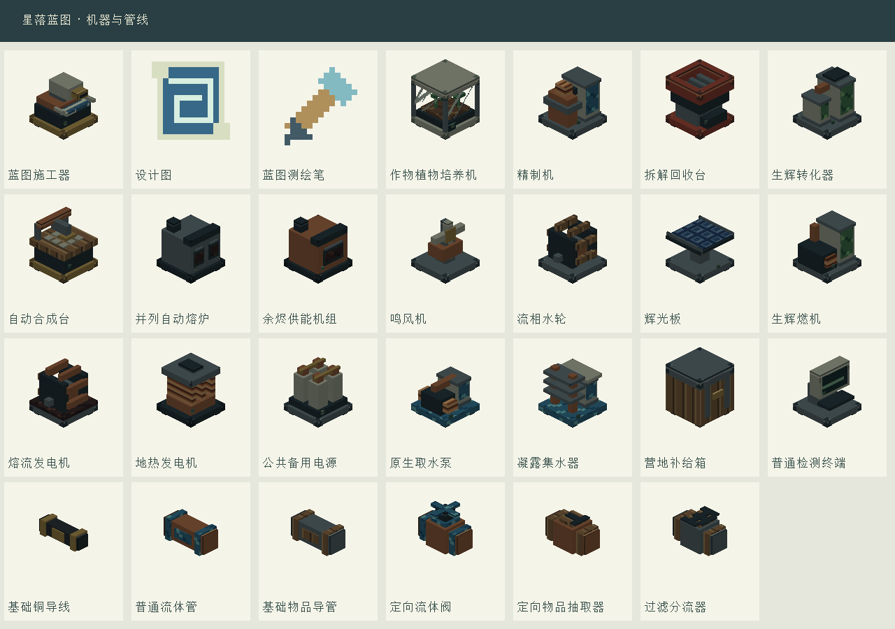
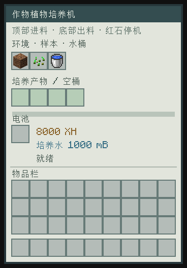

# 界面与机器外观

## 操作

培养机只保留环境方块、植物样本、水桶、成品和电池槽，以及进度、水量、储能与状态。环境和样本保留；顶部自动投入，底部自动取出成品和空桶。

普通设备不再提供六面开关、手动停机、保留数量、六种组件过滤模式或液体白名单按钮。精制等仍有一对配方选择箭头；整备台统一按来料自动加工，不分模式；自动合成使用成品样品并保留库存翻页。水与电通过对应管线自动连接，物品方向固定。煤燃料仍可从侧面送入，自动合成仍允许侧面输入库存；这些方向规则无需配置。

物品抽取器固定背面抽取、正面输出。物品分流器固定背面输入，左／前／右输出，白名单的三列对应三个分支。抽取器、分流器和补给箱直接显示白名单槽：持物点击设置，空手清除，全空不限制物品；仅按物品种类筛选。其他机器没有幽灵过滤槽。

所有工业机器与管线由红石信号停机，移除信号恢复。基础整备台与合金混料炉也支持红石停机。停机保留已预约的批次；不会再次消耗同一批原料。打开旧存档时清除已移除的手动停机、面开关、保留量及复杂过滤设置；原料、液体、储能、模板与在制批次保留。

## 外观

24种机器重新建立独立方块模型，使用原创像素金属、铜、木、玻璃、线圈与光伏材质；8种输送节点有独立的细管和控制部件。

| 用途 | 可见结构 |
| --- | --- |
| 植物培养 | 玻璃舱、土壤、植株与顶部生长灯 |
| 精制与生辉 | 液柱、反应罐、铜管与处理模块 |
| 合成与冶炼 | 九格工作台和夹头、双炉门、坩埚与烟道 |
| 发电 | 风叶、水轮、光伏板、熔流叶轮、地热线圈 |
| 储能与供水 | 四联电池与母排、水泵电机、凝露散热片、开口集雨盘 |
| 输送 | 绝缘电缆4/16格，铜水管与物品导管6/16格；阀门有手轮，定向节点有箭头 |

管线的选择与碰撞范围随连接分支变化，异类管线不会接成一条线。控制节点的固定接口随放置方向旋转；旧存档中的管线在区块加载时重新生成可见连接。

目前单格设备已有足够的顶部、底部和侧面接口，因此这次没有加入必须搭建才能工作的多方块结构。

## 重建

```powershell
python tools/generate_industrial_models.py
python tools/preview_industrial_models.py
```

目录生成器会在最后重新应用工业模型，避免通用方块模型覆盖新外观。预览图由真实模型JSON和PNG材质渲染；客户端验证另使用显式 `-Dstarfall.visualCheck=true`，在独立游戏目录显示模型画廊和培养机界面、保存截图后退出，不创建世界或读取玩家存档。

## 实际客户端截图





## 共面闪烁修复

模型生成时裁掉被不透明构件遮住的面，并对相交构件的同向共面区域只保留一层。罐体与金属箍的顶部不再重复绘制；管线分支止于接头边界。玻璃的透明区域仍保留后方结构。执行 `python tools/test_industrial_models.py` 可复核罐盖、局部裁剪、玻璃透视与全部生成模型的共面重叠。
