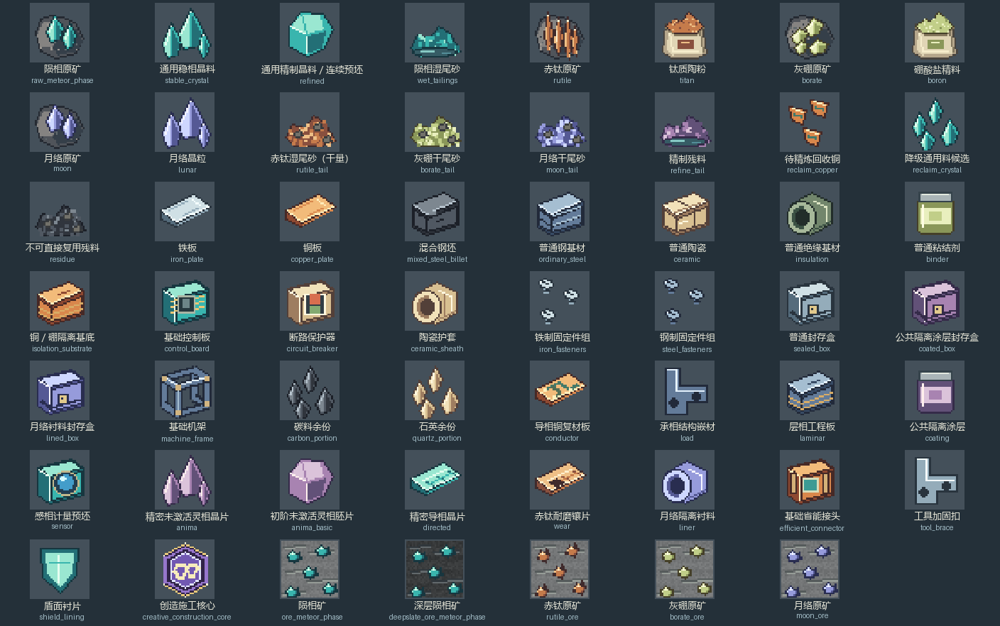

# 矿物与材料像素贴图

49 个材料图标、5 个矿石方块和创造施工核心采用原生32×32像素绘制，最近邻缩放，不复制其他模组资源。

- 陨相：青绿晶簇；赤钛：橙褐针状矿脉与陶粉；灰硼：浅黄绿片状矿簇与精料；月络预留资源：淡紫晶体。
- 原矿保留岩壳，晶料突出棱面，精制晶料使用切面轮廓；粉末、湿尾砂和回收碎片分别绘制。
- 板材采用薄片轮廓；钢基材是叠条、机架是镂空支架；线板、保护器、罐装粘结剂、管状护套、固定件和封存盒按用途绘制。
- 铁、铜、钢分别采用银灰、铜橙和蓝灰色。高光、断面和阴影共同区分材质，避免仅换色。

运行 `python tools/generate_material_textures.py` 可重建贴图与下方总览。基础、结构件及蓝图资源生成入口均接入此绘制流程，后续生成不会恢复旧占位贴图。此脚本只写纹理PNG，不改配方、方块模型或矿物生成。

