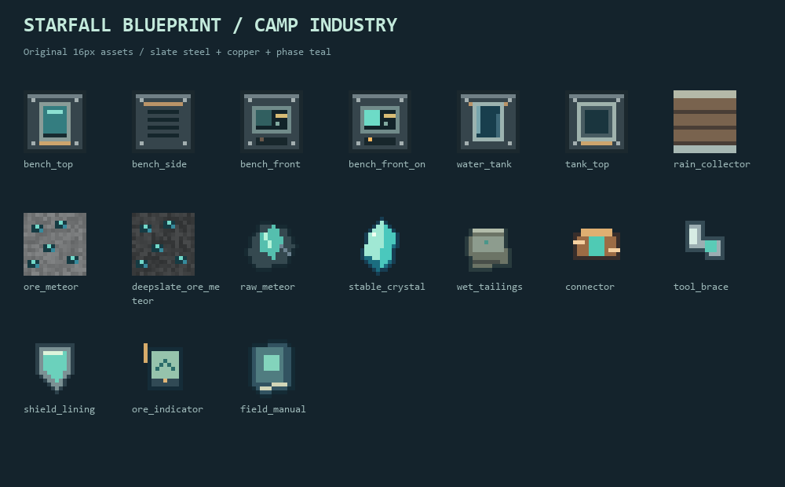

# 原型使用与开发说明

植物培养机现行操作见[培养指南](PLANT_CULTIVATION.md)：保留环境和样本，400tick／250mB／8000XH循环生产，88种原版样本；当前121/121服务端验证与完整构建通过，新增植物家族覆盖断言，全部88样本完成400tick生产核对。见[扩展证据](verification/2026-10-23-plant-coverage-gametest.txt)；客户端与压力仍未验收。

> 现行补充：赤钛／灰硼需铁镐；控制板、六类基础发电与Ⅰ级提速／扩批各需1份Q0晶料，自动化通过控制板继承陨相门槛。首整备、混料和勘探准备无需先取得陨相。新增熔流／地热发电、余烬熔炉API燃料与岩浆桶真实返桶，完整构建114/114服务端测试通过。见[材料阶段](MATERIAL_PROGRESSION.md)、[能源操作](ENERGY.md)和[本轮证据](verification/2026-10-23-energy-gametest.txt)；下文107／106／97等保留对应阶段历史。

本文集中记录当前原型的玩法、配方、构建方式与阶段验证。项目介绍见[仓库首页](../README.md)，最新模块状态见[开发进度](PROGRESS.md)。下文验证记录按各阶段保留，具体覆盖范围以对应证据为准。

当前制造顺序与各阶段配方以[材料与制造阶段](MATERIAL_PROGRESSION.md)为准；下列验证记录保留对应阶段结果。

## 已实现内容

- 主世界陨相矿与深层宿主变体，铁镐及以上采收；不额外生成五种功能矿。时运同时增加原矿份数和较高品位的概率，普通/深层规则相同；正确镐附精准采集现可取得四种已开放矿石的方块，用于合成共振基底；普通开采保留原矿掉落。见[共振基底规则](RESONANCE_BASES.md)，下文较早的精准采集说明为历史。
- 服务端物料组件：材质、干量、陨相组分量、完整度、污染、形态和路线。每份晶料10M，原矿1000M。不同品质保留独立堆叠。
- 整备台 PC-R01：200刻（20TPS时10秒），每批250mB水、40,000XH，煤/木炭320,000XH。G6/12/24分别产5/10/20份P90%通用晶料；完整度扣2；尾砂保留全部剩余干量和陨相组分。
- CB-01省能接头：11种加工机通用，每格64件并跨槽叠加，n件使耗能乘9／(9+n)。1件用于原矿整备仍为36,000XH；升级预算在批次开始冻结，工作中禁止换装。详见[统一升级](MACHINE_UPGRADES.md)。
- CB-02工具加固扣、CB-03盾面衬片：通过工作台安装，最大耐久+20%，按向上取整的损伤比例保留损耗，不增加采掘等级，不可重复安装。
- CB-04近距寻矿指示片：右键扫描8格球形范围、40刻冷却；只报告有无信号，不暴露坐标或品质，不加载区块。
- 整备台中文/英文界面、实时进度、停机原因、水量、余能、自动亮起与四向摆放；中文营地手册和三项入门进度。
- 漏斗自动化：顶面投矿，侧面投煤，底面取成品与尾砂；NeoForge普通水输入接口。原版漏斗本身不能输水，可手动用桶补水。
- 加工前同时验证水、能源与两种出料空间；批次预留输入，欠能/堵塞暂停；保存、卸载、拆移后续作，不补算离线产量。
- 机器拆除打包真实库存、水、余能、接头及在制批次到唯一机器物品，不另掉一份内部库存。
- 常压储水罐与营地集雨器：4000mB空罐出厂；真实露天降雨收集100mB/秒，底面直接朝下供水；可把集雨器放在整备台或常压罐上方。晴天不产水，已存水仍可流出。桶装取水与拆移保持库存；已有水的罐升级集雨器时继承实际水量。
- 可合成的工务终端方块：CB-05每份合格Q0晶料换1铁，全世界所有玩家、终端与维度共享每日4笔，满包失败不扣材料或额度。
- 原创16×16像素方块/物品贴图、深色工业界面及可重复生成的源脚本。
- L02普通结构与电控线：ST-01至ST-14，整件物品投料、合金混料炉与基础机架，完整配方见下表。基础机组、电网、物流与公共精制已接入，完整剧情及未来维度仍待后续实现。

## 供能选择

余烬机组支持实际熔炉API燃料，煤320kXH、岩浆桶4,000kXH，最高500XH/t；桶等余物到右侧成品槽，底部可抽取，出料堵塞不消耗新燃料。熔流机利用同源共享的流动岩浆200XH/t；地热机读取正下方点燃普通篝火40、灵魂篝火60、岩浆块80、岩浆源160XH/t，两机不消耗热源。风、水轮、日光与生辉液路线仍可使用。新机同样要求制造时投入Q0晶料；完整配方、源追溯限制和接线见[能源操作说明](ENERGY.md)。

## 自动合成台

选择机器支持的目标配方（普通配方沿用已学范围，显式库存配方按已加载定义提供），将足量材料投入任意输入格，供电并连接输出即可连续制造；同一成品的不同配方仍按配方ID分别选择。自动合成台按选定配方汇总库存取料，不要求摆放九宫格；54个输入格分6页，自动化访问全部输入，顶面或侧面进料、底面出料。单项需求可超过64份，显式扩展配方可超过3×3；物品仍遵循正常堆叠上限。每批40刻、4000XH，成品和容器余物共用4个输出格。无关材料不会妨碍配料，品质与组件限制保留；不要把“可输入容器”理解为自动读取容器内部库存。

普通配方自动安排逻辑布局；大数量或大于3×3的扩展配方需数据包数量配方或显式模组接口。标准定形／无序配方与本模组显式布局适配保留原配方组件、品质、动态成品及余物语义；设备和容器可作为原料，但不会自动打开容器。未知特殊配方需显式接口，不能由成品猜测。数量配方最多54条需求、3456总数量，布局最多54逻辑格，实际仍受输入占格与4格输出容量限制；未宣称所有第三方模组兼容。旧输入保留第一页，翻页不改变物流可见库存。

2026-10-22本阶段集中完整构建及真实NeoForge服务端94/94项GameTest通过（原85项＋8项AutomaticCraftingGameTests＋1项AutocraftingMenuGameTests），构建耗时23秒；360份JSON、PNG和本地引用校验通过。未进行客户端或压力测试，未验证全部第三方模组。完整说明见[自动合成台使用与扩展](AUTOMATIC_CRAFTING.md)，记录见[本阶段验证证据](verification/2026-10-22-automatic-crafting-gametest.txt)。下方手工配方的九宫格摆法仍适用于普通玩家工作台。

## 16色混凝土生产

自动合成台沿用原版配方：4沙子＋4沙砾＋1染料→8同色粉末。整备台直接投入粉末，无需切换模式，每批8同色粉末＋1000mB水，40刻／4000XH产出8同色原版混凝土；16种颜色均已接入。

最简纵向布置：自动合成台→朝下漏斗→整备台顶部→底部漏斗→成品箱。泵与管道送水，现有电源与电缆供电。整备台侧面只供燃料，粉末必须顶部进料。原料、染料和燃料由外部供应；单漏斗限150件／分钟，不能按机器理论240件／分钟承诺整线产能。

最新完整构建及97/97项服务端测试通过，包含真实机器连接的两批连续生产；详细用法见[混凝土产线指南](CONCRETE_PRODUCTION.md)，实际范围见[验证记录](verification/2026-10-22-concrete-gametest.txt)。上方94项为自动合成阶段历史结果。

## 生存起步

1. 用纸+圆石无序合成营地工务手册，右键阅读。
2. 在新生成的主世界区块先用铁镐采赤钛与灰硼（Y=-32至80），普通熔炉每块原矿烧成2份辅料。用硼盐做寻矿指示片，用钛硼做采样与探索装备，再寻找Y=-64至32的陨相矿；陨相仍需铁镐以上。
3. 在工作台制造整备台：

   ```text
   铁 铁 铁
   石 铜 石
   石 空 石
   ```

   石为圆石，合计3铁、1铜、4圆石，不需要晶料或控制板。

4. 水桶右键整备台加水，一桶1000mB支持4批。空手或普通物品右键打开界面，左上放原矿，左下放煤/木炭。每批10秒。潜行持空桶右键可取回整桶剩水。
5. 晶料+铜锭无序合成省能接头，放入机器左侧统一升级面板任一格。界面本批预算可能仍为40kXH：新接头从下一批起生效。
6. 继续制造基础成品：

   | 成品 | 配方 | 使用 |
   | --- | --- | --- |
   | 工具加固扣 | 晶料在上、铁锭在下，竖直两格 | 加固扣+普通镐无序合成 |
   | 盾面衬片 | 晶料在左、铁锭在右，水平两格 | 衬片+原版盾牌无序合成 |
   | 寻矿指示片 | 铜锭+红石+玻璃+硼盐，无序 | 手持右键 |

   晶料配方在服务端检查Q0品质，低I/污染/错误形态或路线不能仅靠物品ID混入。加固扣与衬片物料相同，以横/竖摆法区分。

加固装备修理与升级：工作台或砂轮合并同类装备，保留任一输入的加固，最大耐久取两者较大值，不重复叠加；工作台按原版清除名称和普通附魔、保留诅咒，砂轮沿用上槽名称和组件。铁砧以左侧为目标，想保留加固时应把加固装备放左侧；右侧只作为修理/附魔材料消耗，不转移加固。加固钻石镐使用原版模板和下界合金锭升级后，按原强化等级重算上限（20%级为2437），按比例向上取整保留已损耐久，并保留名称和附魔。

水4000mB、普通尾砂槽最多16批同种尾砂。晶料库存满、尾砂库存满或品质不兼容会停机；取走产物后自动恢复。

储水罐：4玻璃围住1铁锭的十字摆法。集雨器九宫格如下（罐为常压储水罐，木为任意木板）：

```text
铁 玻 铁
玻 罐 空
木 木 木
```

集雨器必须露天且处于真正下雨的生物群系；放在整备台正上方即可自动补水。普通储水罐本身不主动泵水。空手右键罐/集雨器查看水量，水桶右键加入，空桶右键取出整桶水。

## L02 整件材料与机器加工

固体按件、板、份操作，不称量M，不合成或退回半份材料。M仅用于后台品质与成分记录，普通提示已隐藏。液体继续使用mB。

| 工序 | 投料 | 产出／工位 |
| --- | --- | --- |
| ST-01 | 竖排2铁锭 | 2铁板，工作台 |
| ST-02 | 1铜锭 | 1铜板，工作台 |
| ST-03 | 横排3铁锭 | 3组铁制固定件，工作台 |
| ST-04 | 3铁锭＋1煤/木炭 | 3钢坯，合金混料炉10秒；燃料另放 |
| ST-05 | 1钢坯 | 1普通钢，普通熔炉10秒 |
| ST-06 | 1黏土球 | 1陶瓷，普通熔炉10秒 |
| ST-07 | 纸＋硼盐 | 2份绝缘基材，工作台 |
| ST-08 | 小麦＋黏土球；可选小麦＋黏液球 | 2份／4份粘结剂，工作台 |
| ST-09 | 1铜板＋1硼盐 | 2份隔离基底，工作台 |
| ST-10 | 铜锭＋红石＋玻璃＋1份绝缘 | 控制板，工作台 |
| ST-11 | 铁锭＋铜锭＋红石＋1份绝缘 | 断路保护器，工作台 |
| ST-12 | 1陶瓷＋1钛粉 | 2陶瓷护套，工作台 |
| ST-13 | 1普通钢 | 1组钢制固定件，工作台 |
| ST-14 | 2铁锭＋玻璃＋1份绝缘 | 封存盒，仅作装配材料 |
| MC-C01 | 4铁锭＋2铜锭＋2圆石＋1组铁制固定件 | 基础机架，9格无序工作台 |

混料炉制造：`铁铜铁 / 石炉石 / 石石石`；石为圆石，炉为普通熔炉，总计2铁、1铜、5圆石、1熔炉。无普通钢、晶料或控制板前置。

右键打开混料炉，上方两格放铁与碳料，下方燃料格单独放煤/木炭；右侧取钢坯，再放普通熔炉烧成钢。煤作配料与作燃料各扣各的。混料炉1件供热煤可支持8批，另需每批1件配料煤/木炭；普通熔炉后续热处理燃料另计。混料炉只在工作时扣燃料余量，缺料、欠燃料和满仓暂停，拆移保留在制批次。普通熔炉保持原版点火后持续燃烧行为。

顶部漏斗输入两种材料，侧面输入燃料，底部取成品。Shift铁锭进入铁槽；Shift煤/木炭在碳料槽为空时先放碳料，已有碳料时进入燃料槽；也可手动放入指定槽。不会自动从碳料槽偷煤供热。

普通工作台每个占用格每次只扣1件；同格堆叠3铁不能替代3个铁原料格。原版拆铁粒和压力板保持可合成。旧余份保留注册以兼容开发存档，不再生产、不出现在创造页，旧半份板不能用于整件隔离基底配方。

图鉴已采用[MC物品与加工规则](../../RE_BFL/04_游戏设定/13_MC物品与加工规则.md)重新生成108条设计配方。所有普通工作台配方≤9件，超过容量的七种设备先合成基础机架；多原料耐温玻璃移到混料炉，晶相复合移到加工工序。图鉴标记“设计配方”的部分仍未接入游戏；当前混料炉只注册钢坯，不宣称三辅矿或专业复合已经完成。研究许可仍待实现。

## 剧情导向与工务终端

后续内容沿既有主线推进：**MAIN-00折桥救援 → MAIN-01白灯安置 → 本星调查**。技术服务于剧情中的实际修复、供水、照明和运输行动；不新增平行教学或练习清单、手册入课及免费包。营地工务手册是可选配方参考，不是强制剧情步骤。依据[战争责任与主线剧情](../../RE_BFL/02_时间线和剧情设定/02_战争责任与主线剧情.md)与[任务与支线索引](../../RE_BFL/02_时间线和剧情设定/03_任务与支线索引.md)；当前剧情NPC与任务运行时尚未实现，上述主线是开发导向，并非已可游玩的任务。

工务终端是可合成方块，提供独立CB-05交易，不是NPC实体。原版有序配方如下，共1纸、4圆石：

```text
空 纸 空
石 石 石
空 石 空
```

持合格Q0晶料右键终端，每份换1铁锭，无研究门槛。按本次实际交互手取样，主副手不重复结算；铁只进入普通背包。全世界所有玩家、终端和维度共享每日4笔，额度写入主世界SavedData，仅主世界日期严格前进时刷新，回拨、回到已见日期或重启不额外补额度。严格使用`isQ0`组件判定；高完整度合格料可用，低完整度、污染、错误形态/路线及缺组件样品均拒收。背包放不下铁不扣晶料或额度；主手最后一份晶料耗尽腾出的槽位允许接铁，副手腾位不能替代普通背包空位。空手、手册及其他非交易交互不发物资。

## 构建和运行

安装JDK21。首次构建需要联网下载Gradle、Minecraft与NeoForge依赖，不依赖其他模组。

```powershell
.\gradlew.bat build
.\gradlew.bat runGameTestServer
.\gradlew.bat runClient
.\gradlew.bat runServer
```

Linux/macOS使用 `sh gradlew ...`。JAR输出到 `build/libs/starfall_blueprint-0.1.0.jar`，安装到双方Minecraft实例的`mods`目录。首次启动独立服务器后需由服主确认Minecraft EULA。本项目不自动接受条款。

资源已提交，正常构建不需要Python。重建美术和数据资源可运行：

```powershell
python -m pip install Pillow
python tools/generate_resources.py
python tools/verify_resources.py
```

## 验证与设计边界

2026-10-20完整构建成功，真实NeoForge服务端**23项GameTest全部通过**：覆盖燃料8批预算、低品位物料守恒、接头10%节能及中途变更、缺水/堵塞/欠能续作、保存恢复、品质合成校验、镐/盾耐久升级和流体接口模拟；另包含生存桶主副手交互、真实储水罐拆放、原版漏斗连续两批生产，以及铁砧材料修理和砂轮单件去附魔。已修复整备台潜行空桶抽水被原版交互链跳过的问题。 逐模块状态见 [开发进度](PROGRESS.md)，验证结果与技术说明见 [实现说明](IMPLEMENTATION.md)。

当前自然生成采用稀疏矿脉原型（每4区块一次尝试、矿脉大小4、Y=-64至32），**尚未实现撞击带分布，也没有完成设定要求的20种子密度校准**。矿块自然密度不因时运改变，采收产出预算须计入时运的份数和品位收益。品位暂收敛为G6/12/24，以避免首版分包取整。普通采收I30—40，时运不提高完整度、加工纯度或路线；保晶采样镐已提供低冲击高I采收，公共精制已接入；时运普通采收仍不提高I。

本轮时运规则（已通过服务端回归）：等级截断为L=0..3，无时运固定1份且不额外抽取数量随机数；L>0时份数为`max(1, random.nextInt(L + 2))`，时运I/II/III最多2/3/4份，也可能仍为1份。G6/G12/G24概率如下：

| 所用时运等级 | G6 | G12 | G24 |
| --- | --- | --- | --- |
| 无时运 | 65% | 30% | 5% |
| I | 55% | 35% | 10% |
| II | 45% | 40% | 15% |
| III | 35% | 45% | 20% |

品质和份数由世界种子、矿坐标及所用时运等级确定，同条件重复计算稳定，无时运保持原输出。普通/深层宿主同规则，精准采集不掉可放置矿块，不能靠重放矿块重抽。每份原矿仍为1000M，整备台按份加工并保持干量和陨相组分守恒。上面的23项通过记录属于此前交互回归；本轮新增3项采收测试，完整构建与真实NeoForge服务端**26/26全部通过**，覆盖时运增产提品、无时运兼容、普通/深层一致、确定性、工具与精准采集边界及超III等级截断。见[本轮时运测试证据](verification/2026-10-20-fortune-gametest.txt)。

当前公共首段自然生存配方直接开放，CB-05为独立限额交易；后续已加入的本星图鉴工业功能与阶段验证见开发进度。剧情NPC、任务运行时与完整阵营研究尚未实现。澄海星与林海联盟及其月络、灵相/MAG内容仅预留，等待未来Minecraft官方新维度更新并适配，不以末地代替：月络自然生成、进口及关联工艺暂停，注册ID与旧数据保留；赤钛和灰硼时运采收仍开放。客户端与多人压力验收按用户要求暂缓；实际游玩节奏仍待验收。

本轮补齐双件修理与下界合金锻造，修复工作台/砂轮合并丢失加固标记后可重复加固、锻造复制旧耐久上限的问题。新增5项真实菜单测试覆盖66种场景，完整构建与真实NeoForge服务端**31/31全部通过**；47份JSON、全部PNG及本地资源引用校验通过。见[修理与锻造测试证据](verification/2026-10-20-repair-gametest.txt)。

本轮补齐寻矿与共享菜单边界，完整构建与真实NeoForge服务端**39/39全部通过**（原31项＋寻矿3项＋双人菜单5项）。确认寻矿主副手共用40刻冷却、不加载相邻未加载区块；物品自身入口也遵守冷却。双人交错取料、关界面、背包容量与接头拆装保持物料和批次能耗守恒。双客户端网络同步、客户端反馈渲染和完整进程重启仍待验收。见[本轮证据](verification/2026-10-20-shared-scan-gametest.txt)。

本轮独立工务终端与CB-05交易完成构建及真实服务端**42/42通过**（原39项＋3项SupplyGameTests），覆盖非交易终端空手/手册仅读不送物、Q0背包事务和真实跨终端/玩家日期共享；51份JSON、全部PNG与资源引用校验通过。见[工务交易回归](verification/2026-10-20-public-supply-gametest.txt)。显式属性启用的独立两JVM真实重启探针也已通过：普通G12/I30原矿的第73刻批次及剩余1笔交易额度保存恢复后，再运行127刻产出10份I28晶料和1份尾砂；最后额度只结算一次，空转20刻不复制。探针仅覆盖机器批次和交易SavedData，不代表所有机器、网络同步、真实玩家库存与死亡全覆盖。见[真实重启证据](verification/2026-10-20-server-restart.txt)。历史11/23/26/31/39项通过记录及证据保留；客户端与多人压力按用户要求暂缓。

## 美术



配色：石板灰钢壳、铜色接口、青绿晶体。贴图直接用代码逐像素绘制，不依赖外部图片、AI图片或额外资源包。预览与贴图由同一源脚本生成。设定与项目美术保持项目默认权利归属，当前未声明对外开源许可。
