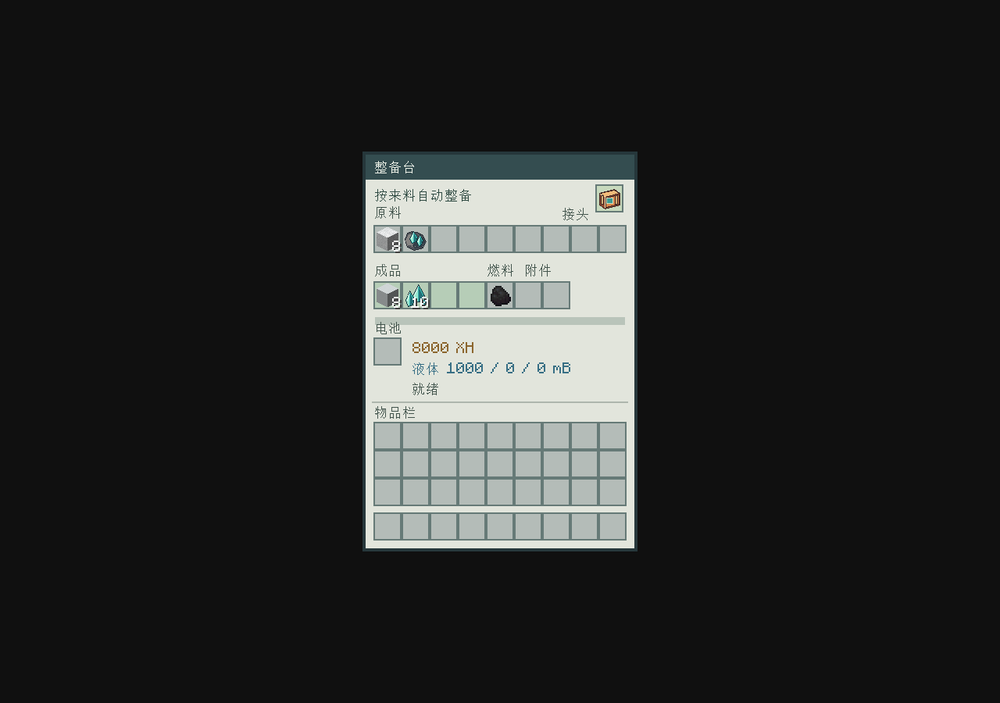

# 统一整备台

整备台只有一种机器、一个界面。原矿和材料直接放进同一个原料区，机器按来料自动整备，不需要潜行或切换模式。

- 上排9格：陨相原矿、赤钛、灰硼、混凝土粉末及其他已支持的整备工序原料。
- 中排4格：所有工序共用成品与尾料区；侧边是煤／木炭燃料、工序附件和电池槽。
- 右上“接头”格：原有陨相整备省能接头，保留不消耗。
- 物流：顶部投入原料，侧面投入煤／木炭，底部取所有成品；煤不会误进原料格。水和电接口通用。

同色混凝土粉末8份＋普通水1000mB＋4000XH，2秒产8份同色混凝土，支持16色。陨相原矿的品质、产率、10秒工时及省能接头规则保留。混合放入时一批一批执行，原矿无法开工时仍会尝试可执行的其他工序。已经预留的批次完成后再接下一批，不同时扣两套成本。

旧存档的原矿与材料库存会合并，原有批次、品质、水和电保留。旧库存迁移碰到满格或不同燃料冲突时，剩余物品继续保存在存档中，腾出空位后自动迁入，不覆盖或删除。旧蓝图里的材料模式标记仅作兼容，已不控制机器行为。

