# 2026-10-29 贝斯特装配台与驾驶仪表验证

本批将上一轮外观/UI审查中的装配信息与驾驶状态问题落实到实际客户端代码。学习费用、制造材料、维护数值、驾驶及钻切规则保持现有定义。

## 实现内容

- 装配台改为工务、轻载、诊断、机甲四个直达标签；完整显示工务知识名称及三项独立知识是否已学，保留300×236界面与原36格背包坐标。
- 机甲页展示材料图标、已有/所需数量；不足项标红。默认查看机甲装配，悬停学习或装配按钮切换对应材料表。禁用操作仍可查看原因、费用及维护效果，材料图标提供物品说明。
- 学习、装配、装卸、隔离、维修、冷却共用一套计划检查。`preview`只操作库存/装备副本；`perform`从服务端玩家重新读取知识与当前库存，只有整个计划成功才提交。材料数量与扣料都使用现有污染、耗尽材料规则。
- 驾驶HUD为248×140仪表，显示生命、电量、热量和磨损；状态区分就绪、钻切电量不足、低电、高热、热锁、隔离、磨损耗尽、驾驶知识不足、无移动电量及机体损毁。
- HUD读取同步热锁真值，温度降至600但仍锁定时继续显示停机。驾驶资格新增服务端同步的展示字段；真实驾驶授权仍由原服务端检查决定。G键请求等待仍仅表示本地请求节流。
- 中英文文案及两仓库玩法指南已同步到生成源。

## 服务端与构建

2026-10-29 17:31:33，真实NeoForge GameTest报告：

```text
24 GAME TESTS COMPLETE IN 965.7 ms
All 24 required tests passed :)
BUILD SUCCESSFUL in 24s
```

组成：机甲11项（原8项加本批3项）、工务诊断5项、轻载5项、野外整备3项。

新增测试覆盖：

1. 预览计数排除污染材料，反复查看所有操作不会扣料、学习或改变库存；已学操作报告正确状态。
2. 可执行预览之后，实际点击前移除知识、拿走材料或塞满背包，服务端均重新拒绝且不部分提交；释放空间后只制造一台机甲。客户端知识快照不能授权服务端执行。
3. 维修、冷却、切档、拆回、隔离预览不会改变实际装备；仅实际选中的维修提交，保留电量、温度、组件档位及累计工作刻。

运行环境：Java 21.0.12.1、Minecraft 1.21.1、NeoForge 21.1.262、Gradle 8.14.3。构建命令（仓库根目录）：

```powershell
$env:JAVA_HOME='C:\Program Files\Java\jdk-21.0.12.1'
$env:GRADLE_USER_HOME='D:\Code\Workspace\.gradle'
$env:JAVA_TOOL_OPTIONS='-Djdk.net.hosts.file=D:/Code/Workspace/StarfallBlueprint/.tools/build-hosts'
.\gradlew.bat --offline --no-daemon -I .tools/mirror.init.gradle build runGameTestServer '-PgameTestNamespaces=starfall_blueprint_mech,starfall_blueprint_diagnostics,starfall_blueprint_mobility,starfall_blueprint_servicing'
```

静态资源验证通过：307物品、245配方、173图鉴；新增界面文案与HUD键均有中英文生成值，两个指南包含只读预览及真实热锁说明。两仓库`git diff --check`通过。

## 真实客户端截图

使用实际Minecraft客户端、NeoForge模型/物品渲染、字体与界面代码截图，分辨率1280×960，GUI缩放2，即640×480逻辑画布。中英文各6张，共12张。英文客户端17:34:09正常退出；中文修正临时配置编码后17:35:37正常退出。初次中文目录截图因配置UTF-8 BOM导致语言项未生效，已用无BOM配置重新运行并覆盖，以下中文截图已目视确认。

所有截图均为**独立无世界样例**：库存、个人知识和HUD资源值由视觉夹具提供，复用真实绘制与预检代码；没有执行制造，也没有模拟服务器成功响应。它们验证界面布局与状态呈现，不代表存档内驾驶或多人验收。

### 装配材料齐备

知识完整、学习按钮禁用、装配按钮可用，8项材料图标及计数位于操作区，未覆盖背包。

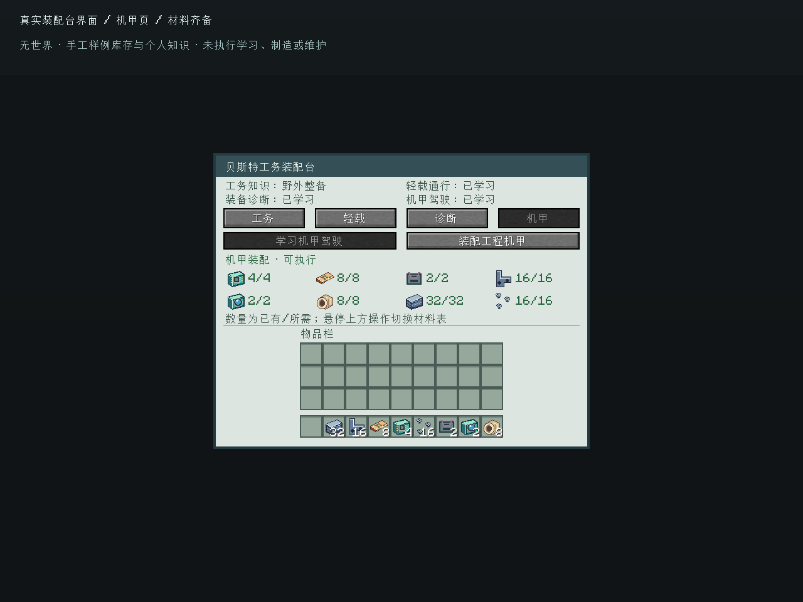

### 材料不足

普通钢3/32、承相嵌材4/16、感相预坯0/2标红，装配按钮禁用，并显示材料不足原因。

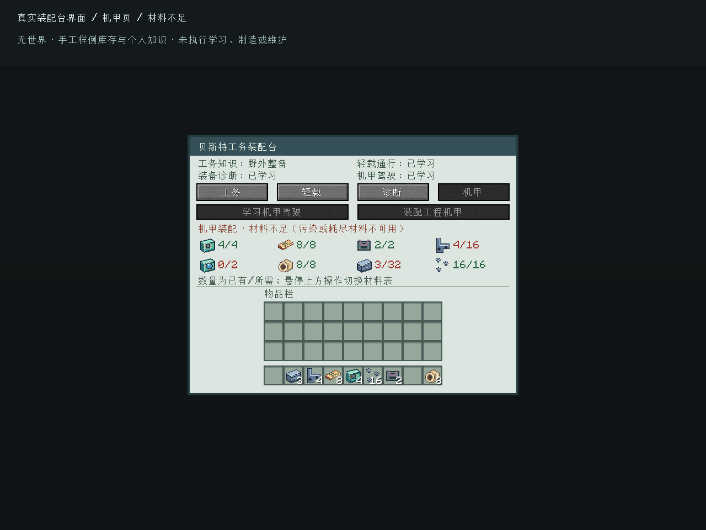

### 知识不足与工务页

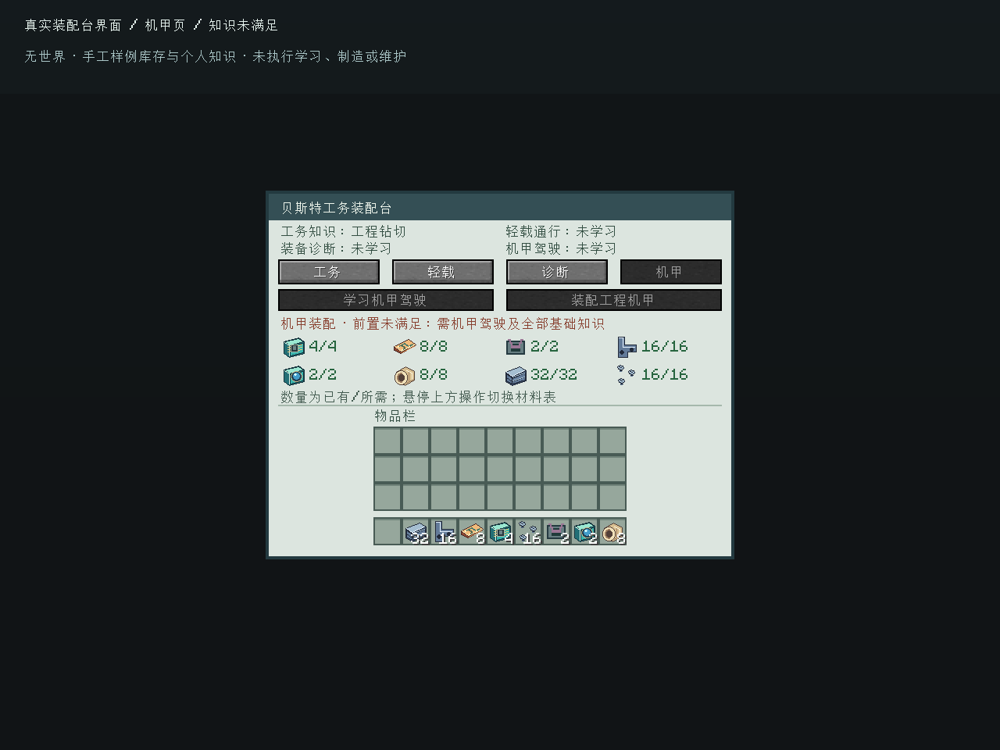

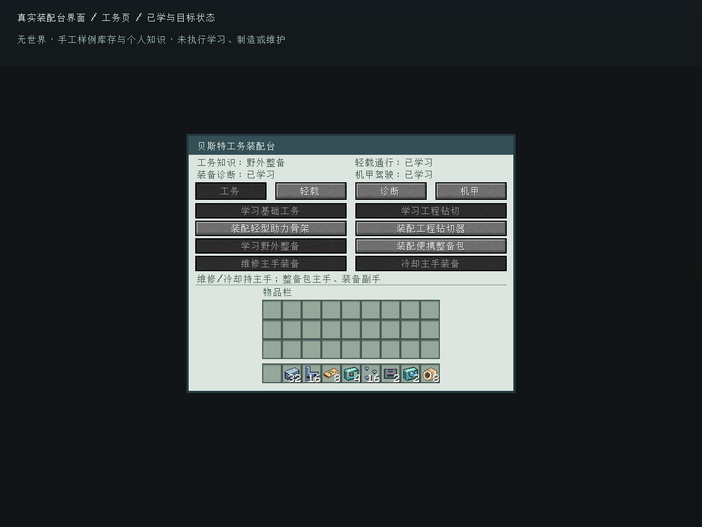

### 驾驶告警与停机

正常状态青绿；20k电量与950热量分别显示钻切电量不足和高热颜色；600热量但热锁仍为真时保持红色停机提示；请求等待使用独立底部文案。

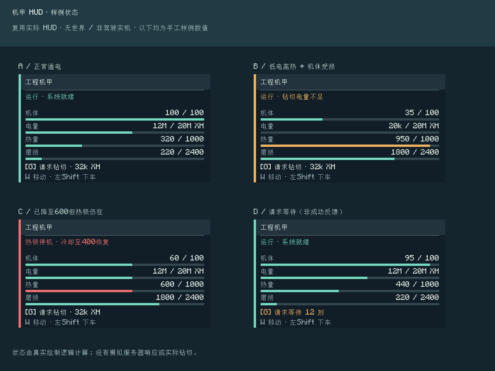

隔离、磨损耗尽、驾驶知识不足、399电量无法移动各有不同状态和颜色。

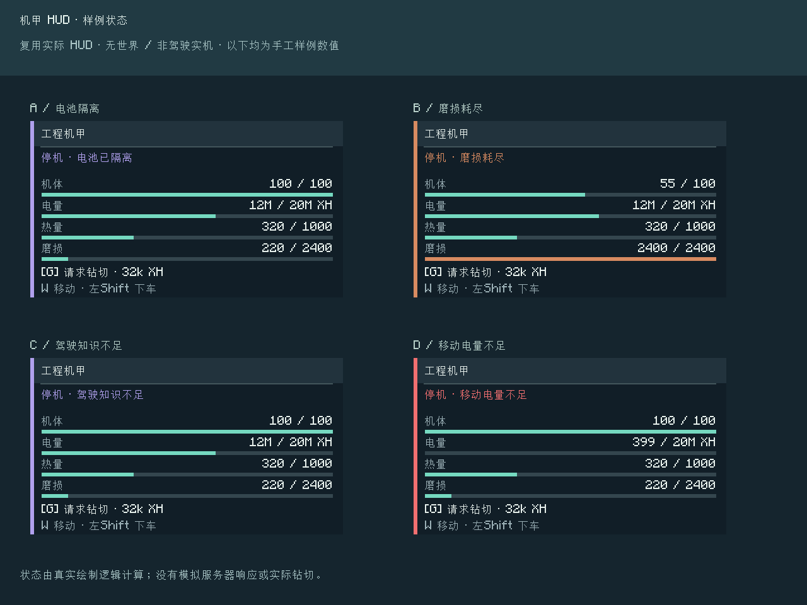

### 英文布局

较长知识、材料原因与操作提示使用现有宽度约束，未见文字覆盖按钮、材料表或背包；英文提示最长行会缩小字号。

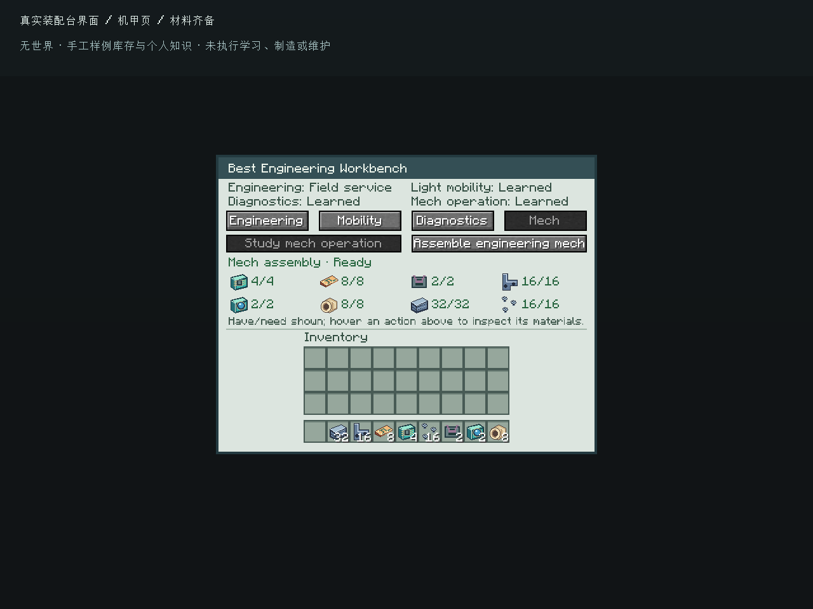

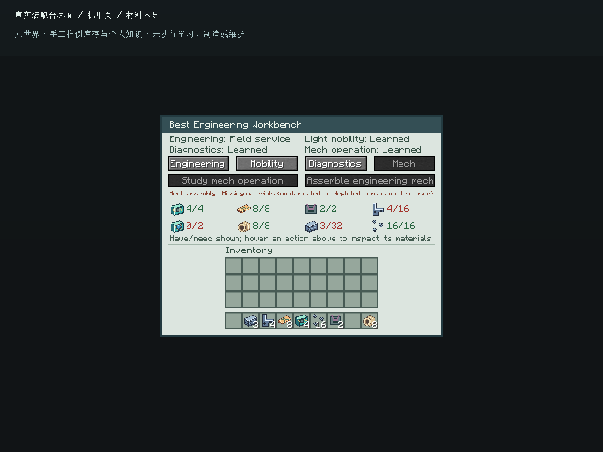

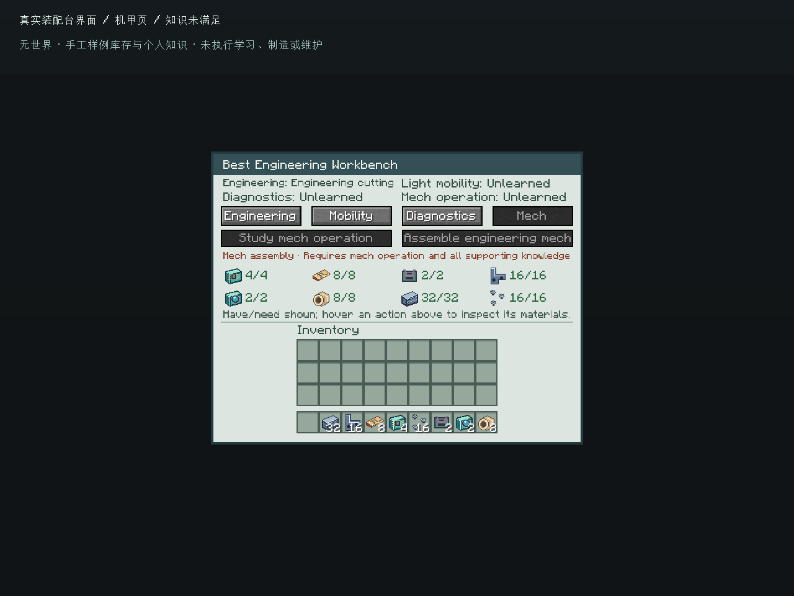

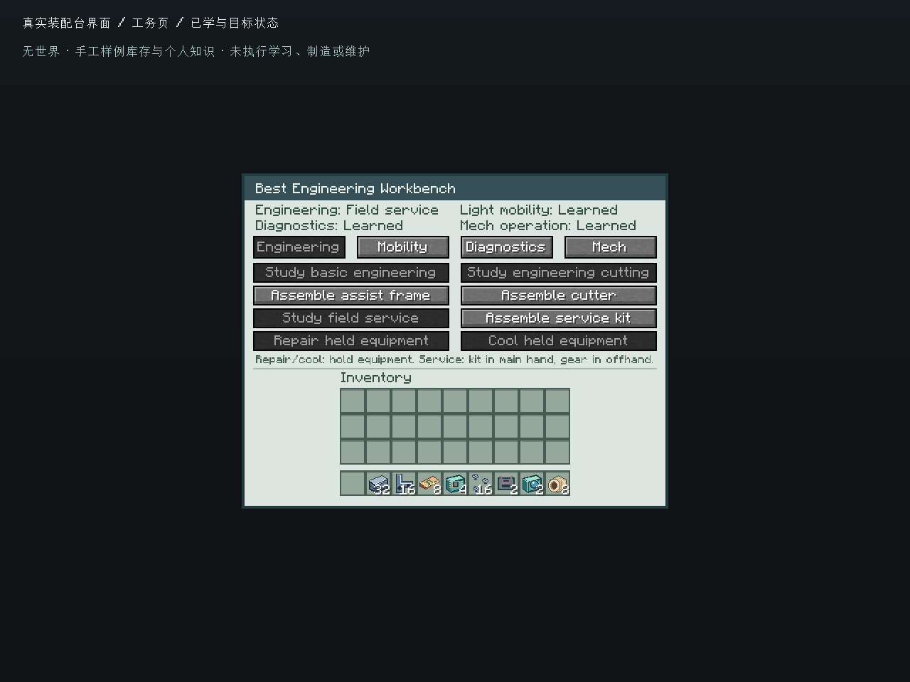

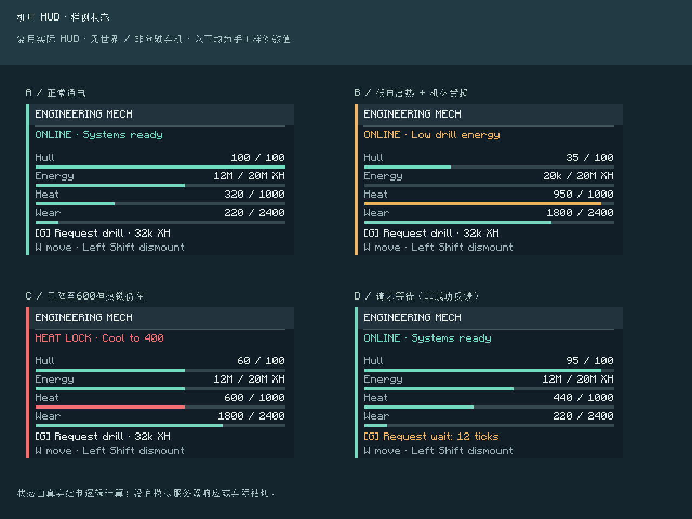

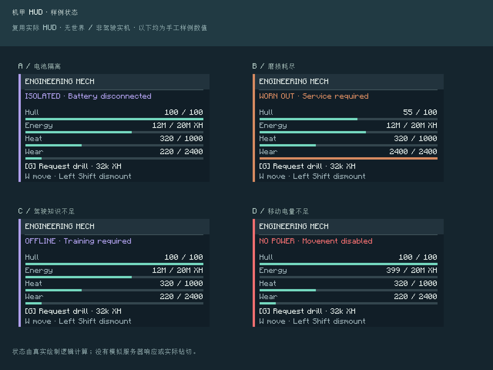

## 验收边界

本批已完成服务端事务回归、实际客户端加载与中英文样例渲染。尚未进行存档内骑乘手感、网络延迟下的状态同步、按键实际钻切及多人联机验收，也未覆盖所有GUI缩放档。客户端出现环境既有`Failed to open OpenAL device`后自动关闭音效，截图与退出正常；离线服务端公钥请求的`UnknownHostException: api.minecraftservices.com`没有影响GameTest通过。均不算作音频或在线认证验收。
