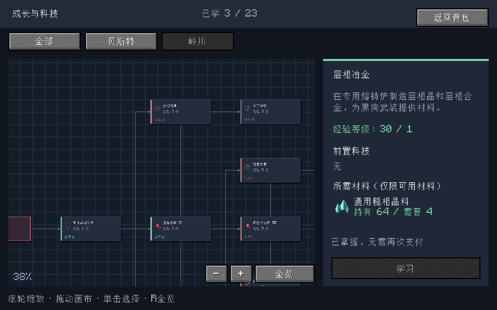
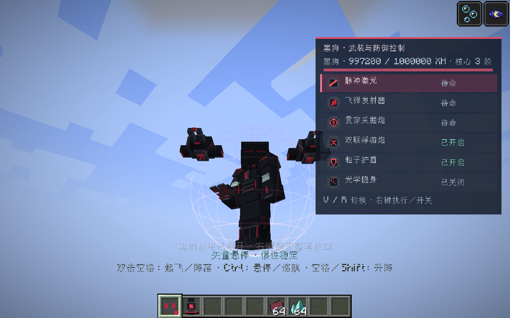
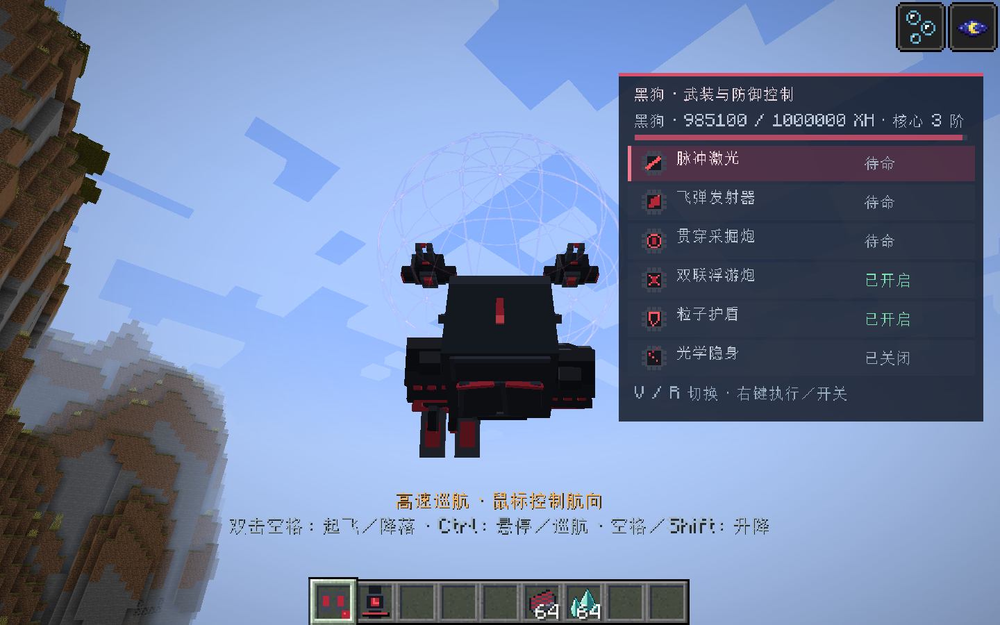
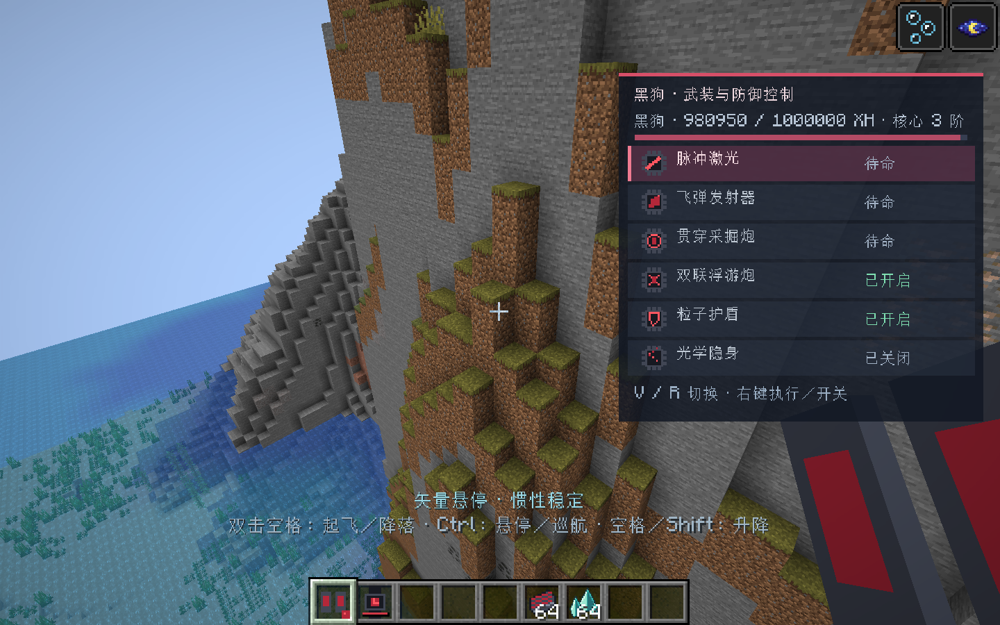
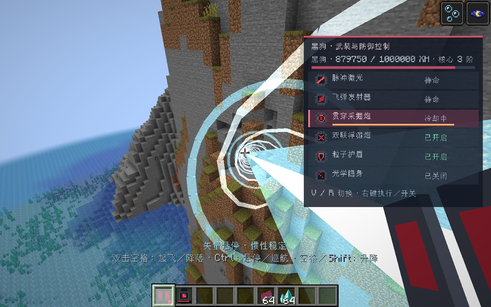

# 2026-11-04 成长树与黑狗战甲操作验收

基于主分支ef79578。增加创造模式全武装腕表，统一成长入口改为可拖动缩放的依赖树；修复夜视续期，增加惯性悬停／高速巡航、终端武装HUD、独立光束与飞弹、双实体浮游炮、护盾开关及脱战回电。

## 构建与服务端

- Java 21、Minecraft 1.21.1、NeoForge 21.1.262；离线`build`成功，产物`build/libs/starfall_blueprint-0.1.0.jar`。
- `starfall_blueprint_lingchuan,starfall_blueprint_progression`共32／32项真实服务端GameTest通过。原有组装、拆装、充电、死亡、保护与成长事务回归通过。
- 新增专项覆盖：模拟连续一分钟夜视始终高于200刻闪烁阈值；保留更强外部夜视；终端权限和未安装系统拒绝；浮游炮生成、关闭与去重；护盾关闭／开启的实际减伤与能耗；真实5秒脱战恢复；巡航与悬停不同能耗、输入超时与收回清理；20格外完整5×5×3黑曜石墙的75块破坏与精确费用，以及容器和后方方块保留。
- 采掘仍使用`ServerPlayer.gameMode.destroyBlock`，保留权限与取消事件，不跨越未加载区块。

## 客户端

使用`run/blackdog-review`独立目录及原存档副本`playtest`运行，验证程序只在显式`-BlackDogPlaytest`开关下启用，并拒绝在正常游戏目录运行。输入使用游戏内控制器状态，未注入操作系统键盘事件；检查在控制器更新后采样。

实际客户端通过双击跳跃输入进入悬停，确认两台浮游炮实体同步；Ctrl输入进入真实`FALL_FLYING`姿态并持续34刻以上，末段速度2.62格／刻（约52格／秒），再次切换返回悬停。生成火控面板、激光、采掘光束及成长界面截图，成长界面由真实服务端菜单打开。修正菜单默认背景模糊覆盖画布的问题，火控面板避让效果图标。

## 操作与边界

成长：滚轮缩放，拖动平移，单击选中，R／全览恢复视野，右侧学习按钮提交原有服务端事务。

战甲：双击空格悬停／结束悬停；空格／Shift升降；Ctrl（原版疾跑绑定）切换高速巡航，鼠标控制航向。手持火控终端时R／V选择系统，右键开火或切换浮游炮、护盾、隐身；六个直达选择键可自行绑定。浮游炮和隐身默认关闭；未飞行、浮游炮关闭、最近5秒未开火／受击时恢复回电。

本轮未进行远端多人往返延迟与大规模同时采掘压力测试；客户端截图为真实游戏渲染，控制器输入验证不替代用户对手感和音量的最终调整。
