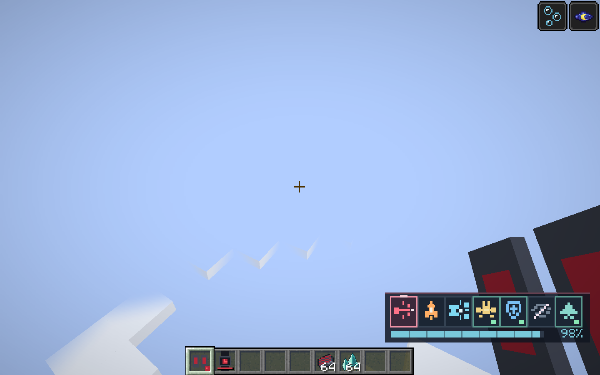
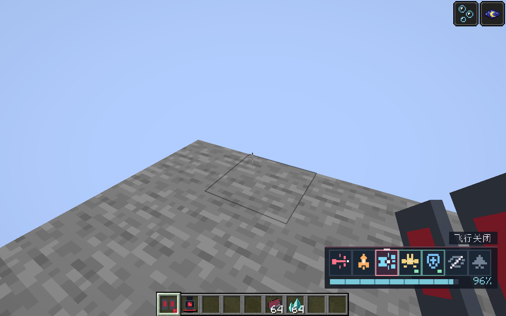
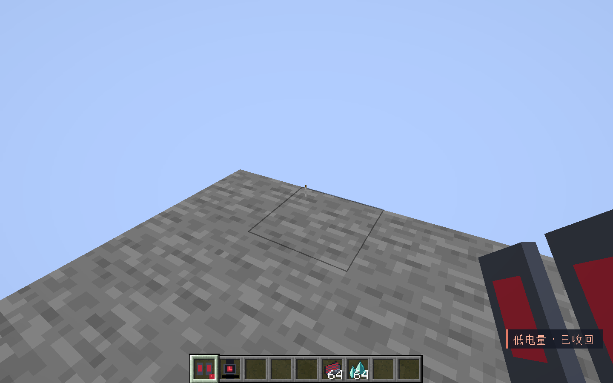
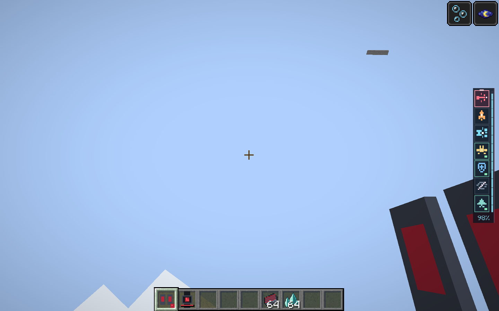

# 黑狗落地、低电量、浮游炮与紧凑HUD验收

本轮优化将装备和能源统一为右下角单行图标条。选中框、开关灯和冷却遮罩保留；功能名称仅在切换后显示1.2秒，能源采用分段条与百分比。六种系统分别使用新绘制的16像素图标，另有飞行图标；基础无武装战甲也有独立布局，避免空列表造成负宽度。生存与水下布局避让原版状态条。低电量收回提示也统一在右下角。

落地自动结束悬停／平飞及推进音效，保留8刻起飞宽限。飞行心跳与明确起飞请求分开处理，落地后的旧心跳不能把玩家再次抬起。低于100 XH运行储备时整套收回，并关闭护盾、隐身和浮游炮，清除飞行姿态、外观投影及属性；创造模式同样清除战甲控制的飞行。充电不自动展开。

浮游炮显示由玩家插值位置与三次贝塞尔编队偏移组合计算；位置包不再与本地动画互相拉扯，偏移保留前段运动切线，瞄准角使用最短角度平滑。

## 验证

- Java 21／Minecraft 1.21.1／NeoForge 21.1.262离线`build`成功。
- 黑狗与成长系统35／35项真实服务端GameTest通过，包含新增落地关闭、延迟心跳拒绝、明确再次起飞、低电量拒绝展开、创造飞行与四件外观清理，以及充电不自动重开。
- 独立`run/blackdog-review`客户端存档副本完成真实游戏渲染和控制器验证：悬停、持续巡航、150度急转向时浮游炮编队位移无跳变、物理触地自动关闭、再次起飞、低电量移除战甲和两台浮游炮模型均通过。
- 截图逐张检查，确认长文字面板和底部常驻操作文字已移除；切换短标签与低电量提示位于右下角。
- 测试使用游戏内控制器状态，未进行操作系统按键注入；远端多人延迟与大规模实体压力测试未覆盖。

产物：`build/libs/starfall_blueprint-0.1.0.jar`。完整控制说明见[黑狗指南](../LINGCHUAN_BLACKDOG.md)。

## 最终UI缩小与竖排复验

按进一步反馈，装备条改为屏幕最右侧垂直居中，图标与边框整体缩至65%，电量条改为图标右侧竖条，百分比置底；切换名称在对应行左侧短暂显示。重新离线构建成功，完整客户端控制器验证再次PASS；检查最终截图，激活灯、选中框和冷却显示均保留。上文单行布局及截图为本日首轮历史版本，最终交付以下方竖栏为准。

