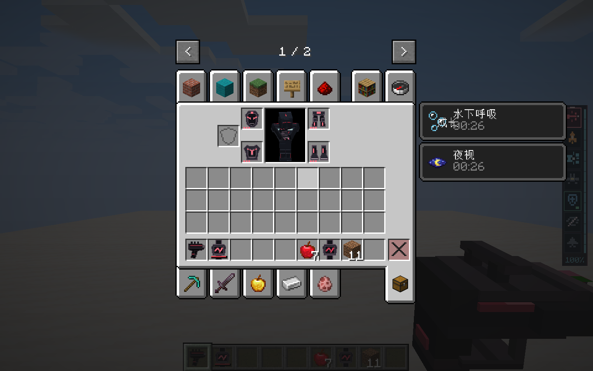
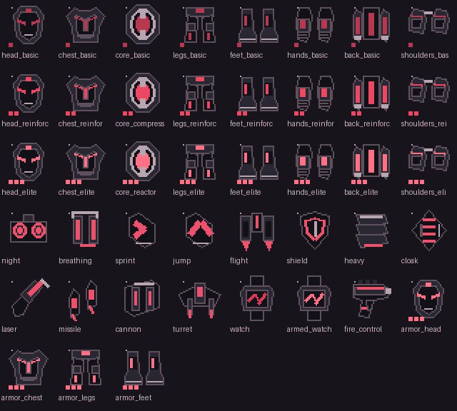
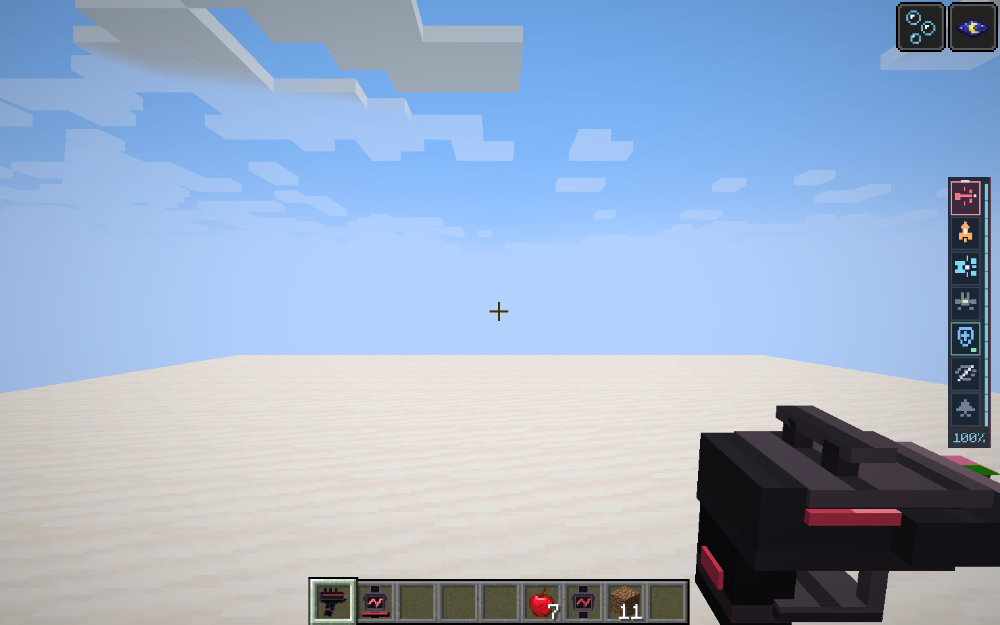
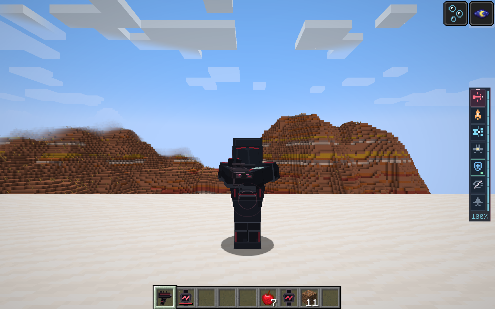
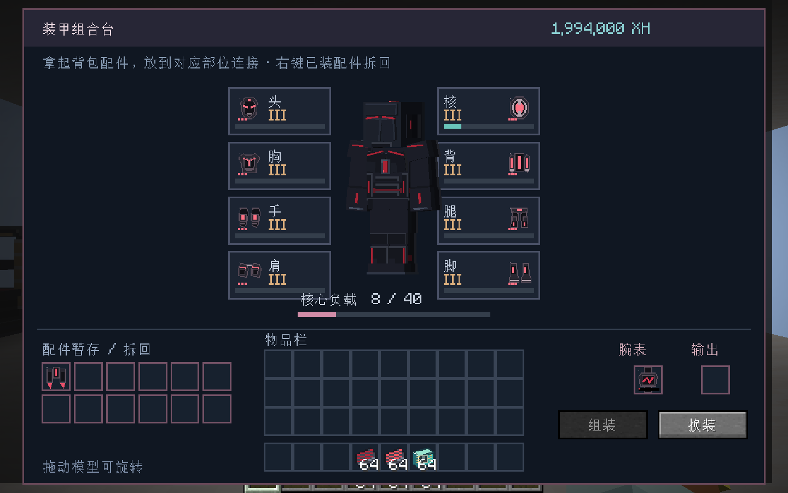

# 黑狗创造背包错位、黑红视觉与低干扰护盾验证

2026-11-05，Minecraft 1.21.1／NeoForge 21.1.262／Java 21。

## 修复与行为

- 创造背包的 `SlotWrapper` 使用菜单序号并代理另一个真实槽位。旧锁定包装直接读取该序号对应的背包物品，导致腕表、终端等错误显示在护甲槽。锁定包装现委托原槽位读写；创造界面保留原代理类型，在打开前锁定其实际目标槽位，兼容原版点击时的类型转换。
- 43张图标统一为黑色外壳和红色能量线，通过部位轮廓、红色亮度和等级刻记区分，移除银青金配色。
- 火控器改为立体战术握柄，含扳机、护圈、感测导轨和红色状态线，单独调整第一／第三人称比例与握持姿态；GUI仍使用2D图标，物品ID和武器控制保持兼容。
- 待机护盾由连续球形网格改为间歇三段淡弧；受击效果在来袭方向接触点产生短促双波纹。第一人称隐藏近身命中圈，保留视线。
- 装配画布只显示实际连接的配件及连线；从背包拿起配件放到部位安装。已有腕表的展示、负载与挂载只读取实际安装配置，拆回暂存的配件不会再次显示为已装备。

## 验证

- 完整离线构建成功；38／38项相关服务端GameTest通过（2.201秒），包含新增创造代理索引回归，以及拆下后暂存物不再影响模型与负载的断言。
- 974份JSON、全部PNG及本地模型／纹理引用检查通过。
- 隔离客户端真实打开创造模式个人背包：四个护甲图标映射正确，逐槽禁止取出，点击护甲代理不崩溃、不取出投影；背包苹果数量7保持不变，服务端四个护甲位均为投影甲。
- 实际第一／第三人称渲染检查火控握柄、待机与命中护盾；缩小第一人称体积并调整第三人称持握方向。
- 实际装配客户端验证从真实背包拾取配件到部位安装、扣除一件配件及5000 XH、右键拆回、未安装图标和连线隐藏，及充电／制造原流程。
- 上述验收均在 `run/blackdog-review/saves/playtest` 副本进行；未覆盖远端多人延迟和全部第三方代理槽位实现。

