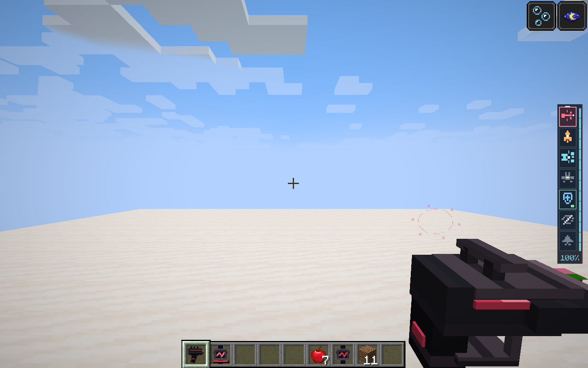
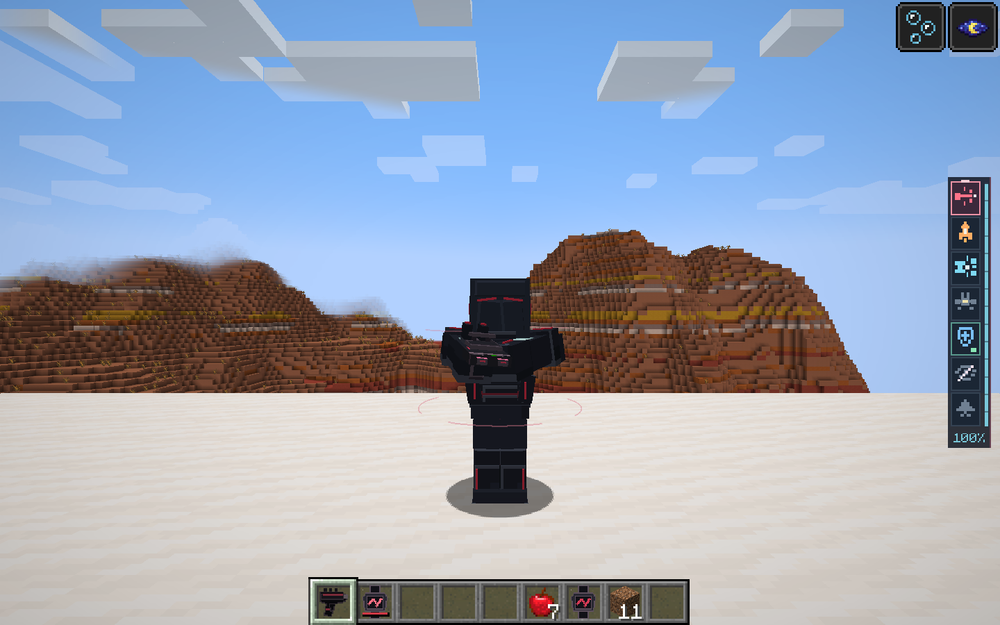

# 柔和护盾与分视角受击反馈

本轮根据“仍需看得见，但不要晃眼”的反馈调整护盾。

- 第三人称：持续的分段腰部与上身弧线，缓慢流动，亮度柔和；受击时接触点扩散双波纹和六点碎光。普通透明混合代替加法叠色，避免白色亮圈与泛白。
- 第一人称：待机不显示。护盾命中实体同步护盾所属玩家ID，只为本人受击绘制准星外侧的小范围破环波纹与碎光；快速连击合并为最新一组，约18刻内消退。
- 护盾吸收伤害、电费、开关和武器行为沿用原有规则。

Java 21离线完整构建通过。隔离客户端 `run/blackdog-review` 完成真实实体所有者同步、创造背包映射回归、第一／第三人称待机与受击截图，结果PASS。逐张检查确认第一人称存在受击反馈且不覆盖准星，第三人称待机与受击均可见。未验证远端多人高延迟和大量同时受击的性能。

