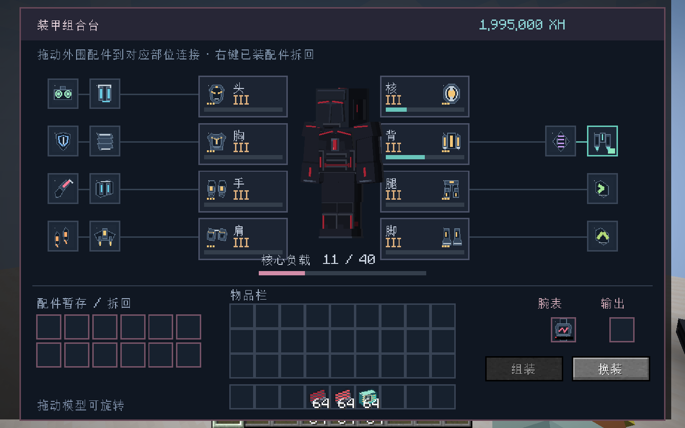
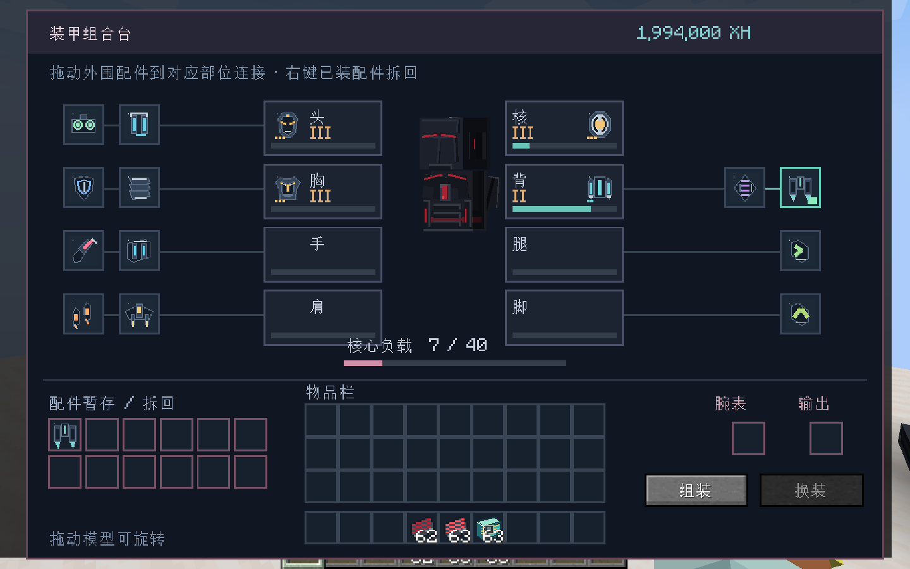
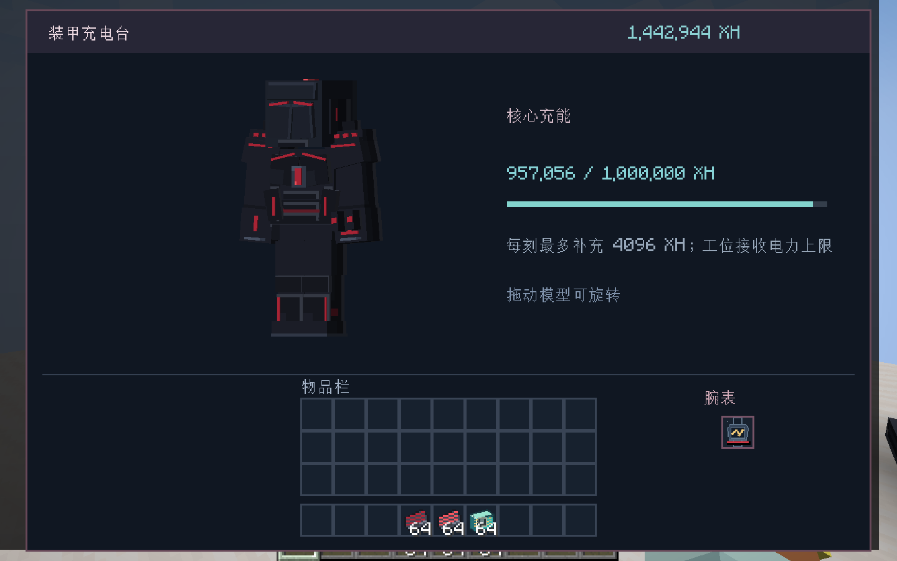
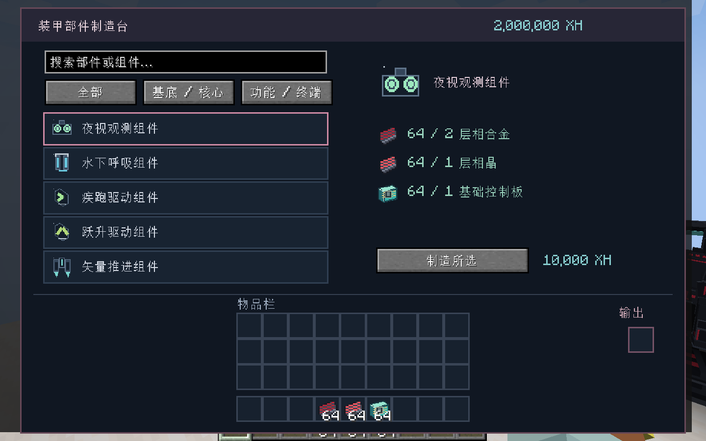
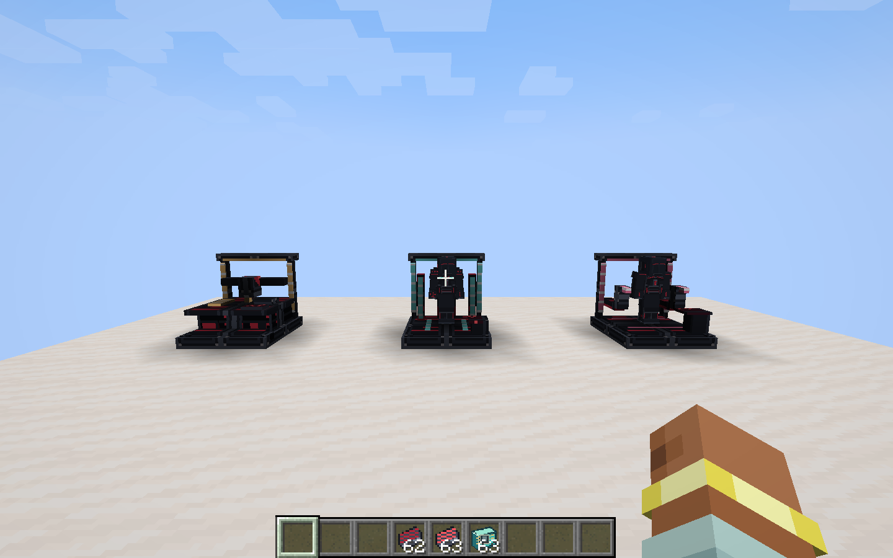
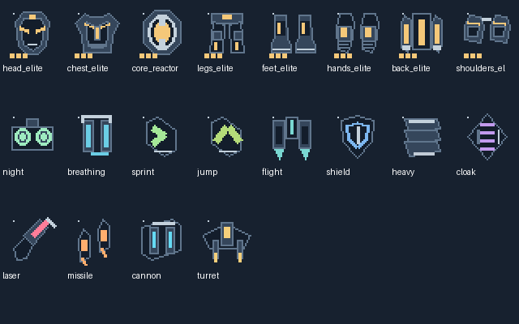

# 黑狗可视化工位、装配画布与硬件图标验收

2026-11-05，Minecraft 1.21.1／NeoForge 21.1.262／Java 21。

## 交付行为

- 装配台改为开放框架、夹持机械臂与控制终端，放入部件后按实际配置逐部位显示战甲；放入已有腕表时显示其基底及武器挂载。充电台放入腕表后展示完整战甲，取出后消失。世界模型仅由主控制器绘制，展示快照每10刻按变化同步。
- 装配界面使用八部位与外围配件连线画布，中央模型可旋转；拖动外围图标到对应部位，或拿起真实配件点击部位连接。显示部位接口与总负载进度条。已有腕表连接一次耗5000 XH，右键拆回暂存耗1000 XH；未完成的新装甲只暂存真实物品，不预收组装费用。
- 部件制造台提供分类、搜索、滚动目录及单项材料详情。制造、装配与拆装继续由服务端检查研究、材料、功率、部位等级、接口和负载。
- 重绘43张32像素物品纹理，基底按轮廓与等级标识区分，组件按真实硬件功能区分；三类工位的物品栏模型显示完整机器。
- 研发台从创造分类和制造配方移除，旧注册与旧存档实体保留，仍可访问统一成长入口。

## 验证

- 最终离线完整构建成功，产物 `build/libs/starfall_blueprint-0.1.0.jar`。
- 37／37项成长与黑狗服务端GameTest通过（2.739秒），新增验证拖放扣费原子性、重复组件拒绝、腕表身份与电量保留、优先使用暂存配件、鼠标持有配件消耗、新装甲部位等级检查、取消暂存返还及精简展示包。
- 资源检查：973份JSON、全部PNG及本地模型／纹理引用通过。
- 隔离存档 `run/blackdog-review/saves/playtest` 的真实客户端完成：画布拖动连接、真实材料与5000 XH扣除、右键拆回、世界模型同步、充电台完整12组件配置、分类制造实际产出，以及只放四部位时的局部模型。结果为PASS。
- 逐张检查装配、局部装配、充电、制造及三类世界工位截图；修正模型朝向、充电预览侵入标题和过长按钮文字。窗口较小时界面统一缩放，鼠标坐标同步换算。
- 未覆盖远端多人延迟、大规模工位压力与全部第三方兼容。测试采用游戏自身控制器及菜单操作，未向操作系统注入输入。

