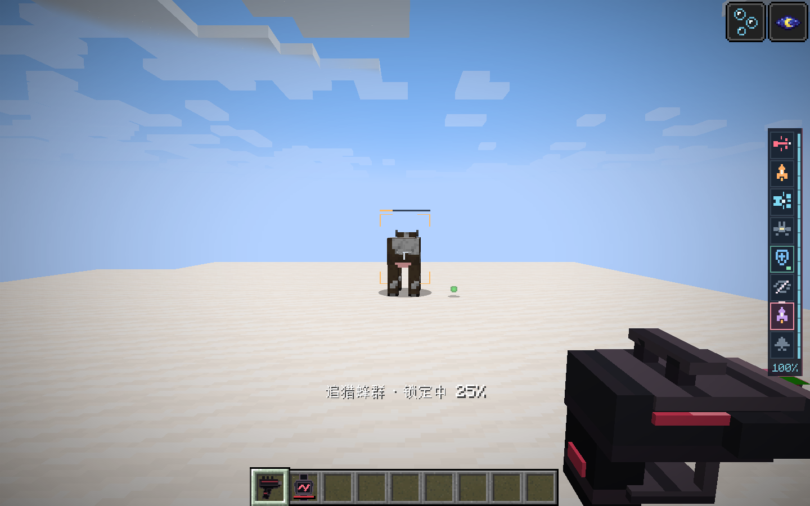
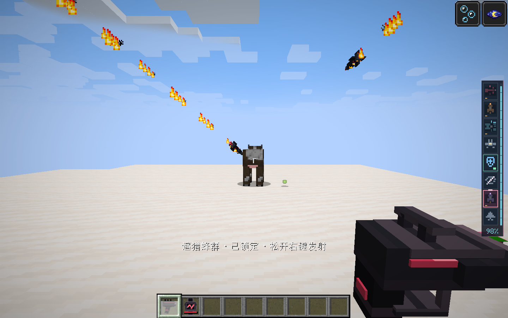

# 黑狗蜂群锁定标记验证

基于 StarfallBlueprint `929035a` 实现；同次已将设定仓库 RE_BFL 更新到 `fbe4dd8`。

目标显示橙色四角框和进度条，16 刻锁定完成后变为绿色。标记跟随目标插值位置并面向摄像机，适用于第一、第三人称；不修改目标的共享发光标志、队伍或同步实体数据。

服务器通过 `PacketDistributor.sendToPlayer` 只向发动技能的玩家发送目标 ID、UUID 和锁定进度。目标 UUID 防止实体 ID 重用造成误标。目标失效、松手、失锁、收回战甲时清除；客户端也检查使用中的火控终端、模式、存活状态、视线及当前世界，超过 10 刻未更新即失效。

验证结果：

- Java 21 / NeoForge 21.1.262：Gradle `build` 成功。
- `starfall_blueprint_lingchuan` 全部 38 项 GameTest 通过。新增测试覆盖锁定目标与进度、另一玩家没有该目标状态、失锁清除、完成锁定、松手清除及战甲收回清除。
- 隔离存档 `run/blackdog-review/saves/playtest` 中的真实客户端测试通过：接收服务器发来的私有标记、目标没有共享发光标志、松开右键后标记消失。已检查锁定中、锁定完成和释放三张截图。
- 复查了地面遮挡问题：框体下沿抬至脚部上方，进度条放在上沿外侧，避免被地面与目标身体遮住。

客户端复现（先准备 `classes prepareClientRun`）：

```powershell
./tools/run_prepared_client.ps1 -JavaExecutable java -GameDirectory "$PWD/run/blackdog-review" -QuickPlayWorld playtest -BlackDogLockMarkerCheck
```

该检查仅允许在隔离的 `blackdog-review` 目录运行，自动截图并退出；不会进入玩家正常存档。





