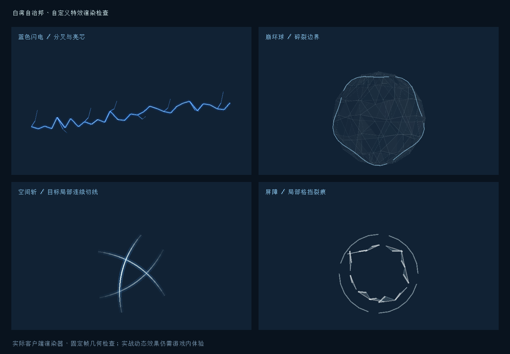

# 白湾自治邦超能力重做验证（2026-11-21）

实现与玩法见 [BAIWAN_ESPER.md](../BAIWAN_ESPER.md)。

- `build --offline` 成功，产物：`build/libs/starfall_blueprint-0.1.0.jar`。
- 使用项目预备的 NeoForge 21.1.262 游戏测试运行时，命名空间 `starfall_blueprint_esper`，16 项必需测试全部通过。
- 覆盖长按服务端超时、提前松开与满蓄爆炸、指向崩坏与禁锢、可见远程群斩、真实物品投射/回收、电荷被动上限和感电回充、创造飞行耗尽、屏障闲置/远程拦截/实际近战事件、地形扭曲的方块守恒与容器/基岩保护，以及既有成长、设备、换系、储物和自空域行为。
- 游戏测试中的模拟玩家没有真实连接输入循环，因此测试显式驱动长按输入与服务端通道时间；实体回收也直接推进弹射物生命周期。未将这些测试描述为真实玩家的端到端按键试玩。
- 实际客户端固定帧渲染检查成功，使用正式特效渲染器绘制蓝色电弧、崩坏球、连续切线和屏障局部裂痕，截图见下。检查客户端已自动退出。
- `git diff --check` 通过。



## 复现

使用本机现有 JDK 21、Gradle 8.14.3 和项目 `.gradle-home` 离线缓存执行 `build`。游戏测试运行：

```powershell
./tools/run_prepared_gametests.ps1 -JavaExecutable '<JDK21>/bin/java.exe' -Namespaces starfall_blueprint_esper
```

客户端几何检查（要求预备 client 运行时，隔离目录的 `options.txt` 已完成首次引导）：

```powershell
./tools/run_prepared_client.ps1 -JavaExecutable '<JDK21>/bin/java.exe' -GameDirectory '<project>/run/esper-rework-review' -EsperVisualCheck
```

## 验证边界

客户端截图验证的是正式渲染器的固定帧几何与颜色，未完成游戏世界中的完整手动动态试玩，尤其没有以截图声称已验证多人延迟、大规模战斗帧率或第一人称实战体验。地形扭曲按共享预算分刻完成，每次至多搬移 64 个普通实心方块；随身空间已满或主人离线时，投射实体持久化保留载荷等待回收，不丢为掉落物。

## 日志与产物

- 构建日志：`.tools/esper-rework-build.log`
- 游戏测试日志：`.tools/esper-rework-gametest.log`
- 客户端日志：`run/esper-rework-review/prepared-client.log`
- 构建产物 SHA-256：`cb1af3c3ffb622d247d61082a4dcf86c7efa893dedbb39ad4e5d131030e77082`
